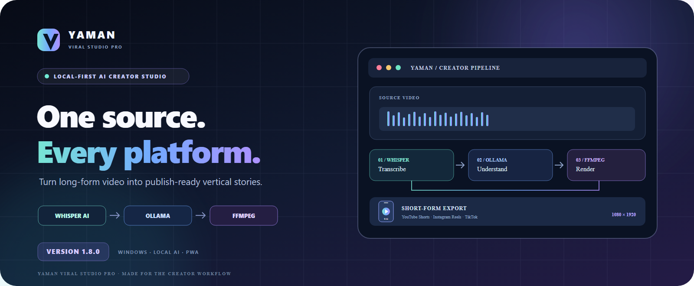
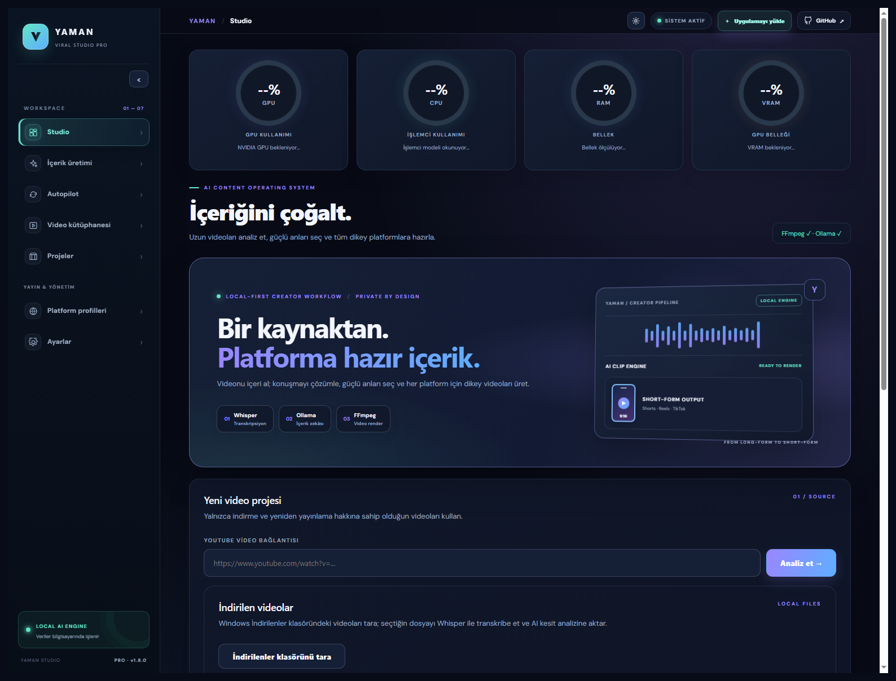
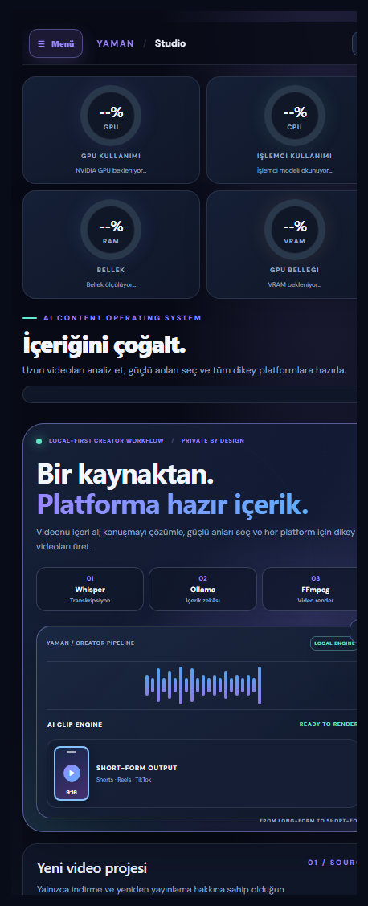
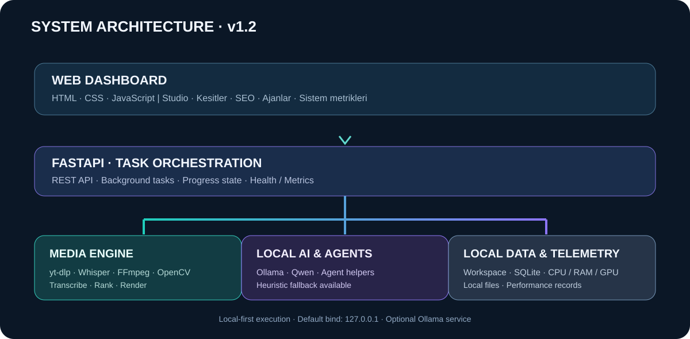

# YAMAN VIRAL STUDIO PRO

<div align="center">



**LOKALE AI-VIDEOPRODUKTION · WINDOWS · PWA**

[](CHANGELOG.md)
[](https://www.python.org/)
[](https://fastapi.tiangolo.com/)
[](LICENSE)

[🇹🇷 Türkçe](README.md) · [🇬🇧 English](README.en.md) · **🇩🇪 Deutsch** · [🇪🇸 Español](README.es.md)

</div>

## ✦ Überblick

YAMAN VIRAL STUDIO PRO ist ein **lokales AI Creator Studio**, das lange Videos in strukturierte, bearbeitete Kurzvideos für YouTube Shorts, Instagram Reels und TikTok verwandelt.

Whisper transkribiert Sprache, Ollama unterstützt die Inhaltsanalyse und FFmpeg schneidet, untertitelt und rendert vertikale Videos. Die zentrale Medienverarbeitung kann lokal auf dem eigenen Computer laufen.

## ⚡ Schnellstart

**Windows 10/11 · Python 3.12 · FFmpeg**

```powershell
git clone https://github.com/Myozan/YAMAN-VIRAL-STUDIO-PRO.git
cd YAMAN-VIRAL-STUDIO-PRO
py -3.12 -m venv .venv
.\.venv\Scripts\Activate.ps1
pip install -r requirements.txt
Copy-Item .env.example .env
.\run_windows.bat
```

Öffne **http://127.0.0.1:8765**. Installiere [Ollama](https://ollama.com/download/windows) für lokale KI-Analyse.

## 🎬 Creator-Werkzeuge

| Workflow | Funktion |
|---|---|
| **Whisper** | Sprachtranskription mit Zeitstempeln |
| **Ollama** | Lokale Inhaltsanalyse, Skripte und Clip-Auswahl |
| **Smart Recap** | Wichtige Momente zu einer Zusammenfassung verbinden |
| **Story Flow** | Erzählstruktur vom Einstieg bis zum Abschluss |
| **Documentary** | Chronologische, quellenbasierte Erzählung |
| **Education** | Lernziel, Schritte, Beispiele und Zusammenfassung |
| **Product** | Produktvideo ohne unbelegte Aussagen |
| **FFmpeg** | Schnitt, Untertitel und vertikaler MP4-Export |
| **Autopilot** | Geplante lokale Produktionsabläufe |
| **Medienbibliothek** | Quellen, Clips und Ergebnisse verwalten |

## 🖥️ Einblicke in das Studio

<p align="center"><strong>DESKTOP WORKSPACE</strong></p>
<p align="center"></p>

<p align="center"><strong>MOBILE WORKSPACE</strong></p>
<p align="center"></p>

## 🔐 Lokal und kontrolliert

- Zentrale Transkription, Analyse und Medienverarbeitung können lokal ausgeführt werden.
- Optionale Dienste wie Runway, Pexels und Edge TTS benötigen eine Internetverbindung.
- Zugangsdaten bleiben im lokalen verschlüsselten Speicher.
- Veröffentlichungen erfordern eine ausdrückliche Bestätigung.
- Verwende nur Medien, für die du die erforderlichen Rechte besitzt.

## ♻️ Updates

Installierte Kopien können den konfigurierten GitHub-Branch prüfen und bei einer neuen Version ein Update anbieten. Vor dem Austausch von Programmdateien wird ein Backup erstellt. Lokale Medien, Einstellungen und Zugangsdaten sollen erhalten bleiben. Updates werden niemals ohne Zustimmung installiert.

## 🧩 Architektur und Dokumentation

<p align="center"></p>

[Changelog](CHANGELOG.md) · [Architektur](docs/ARCHITECTURE.md) · [Integrationen](docs/PLATFORM-INTEGRATIONS.md) · [Demo](docs/DEMO.md) · [Beitragen](CONTRIBUTING.md) · [Sicherheit](SECURITY.md) · [Lizenzierung](LICENSING.md)

## ⚖️ Lizenz

Community-Quelldateien, die durch die Root-Datei [LICENSE](LICENSE) abgedeckt sind, stehen unter MIT. Drittanbieter-Abhängigkeiten und Dienste behalten ihre eigenen Lizenzbedingungen. Details: [LICENSING.md](LICENSING.md).

<div align="center">

**YAMAN VIRAL STUDIO PRO · v1.8.0**

*Lokal erstellen. Intelligent bearbeiten. Überall veröffentlichen.*

[Repository](https://github.com/Myozan/YAMAN-VIRAL-STUDIO-PRO)

</div>
