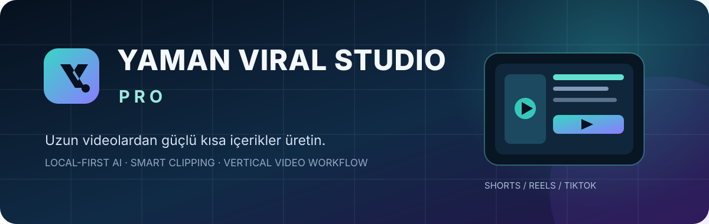
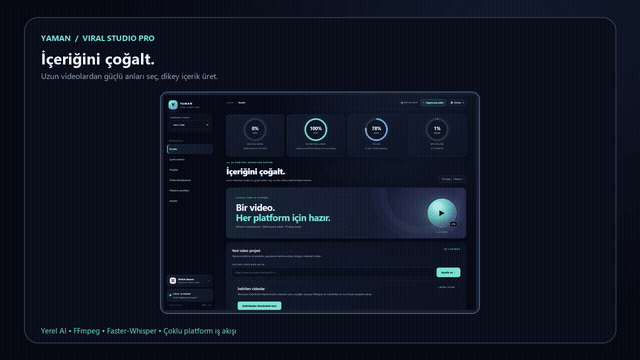
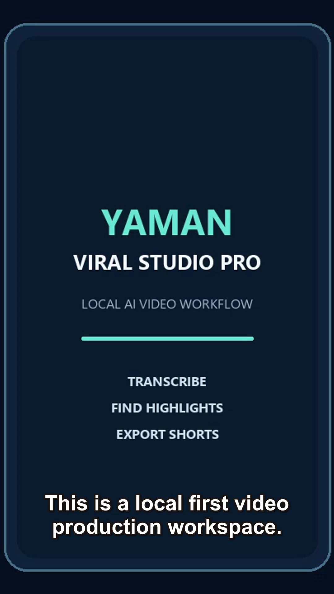

# YAMAN VIRAL STUDIO PRO

Local-first **AI video repurposing studio** for video analysis, speech transcription, highlight discovery and vertical clip production for YouTube Shorts, Instagram Reels and TikTok.

<p align="center"></p>

<p align="center"><a href="https://github.com/Myozan/YAMAN-VIRAL-STUDIO-PRO/actions/workflows/ci.yml"></a>   <a href="LICENSE"></a></p>

<p align="center"><a href="README.md">Türkçe</a> · <b>English</b> · <a href="README.de.md">Deutsch</a> · <a href="README.es.md">Español</a></p>

**Search terms:** AI video editor, video repurposing, YouTube Shorts generator, local LLM, Ollama, Faster-Whisper, FFmpeg, Reels, TikTok.

**v1.5.2 · PWA + responsive UI.** Desktop and mobile workspace previews are included below. The SVG previews are illustrative design assets, not live application screenshots.

## Core capabilities
- Import eligible YouTube sources or local videos from Windows Downloads.
- Transcribe speech with Faster-Whisper and export timestamped transcripts.
- Identify candidate short clips with local AI analysis.
- Render vertical videos with captions for Shorts, Reels and TikTok.
- Coordinate specialist AI agents and persistent task history.
- Configure local Ollama and Whisper models.
- Track GPU, CPU, RAM and VRAM telemetry.

## Live product preview

[Watch the 20-second MP4 overview](docs/assets/showcase-demo.mp4) · [Animated GIF preview](docs/assets/showcase-demo.gif) · [GitHub social preview PNG](docs/assets/social-preview.png)



## Live application screenshots

Captured from the current repository branch while the local app was running. The compact capture uses a 600 px viewport; system metrics vary with hardware load.

| Desktop | Compact viewport |
|---|---|
|  |  |

Illustrative SVG design previews: [desktop](docs/assets/dashboard-desktop.svg) · [mobile](docs/assets/dashboard-mobile.svg).

## End-to-end production demo

**The app imported a source video, transcribed its speech, selected clip candidates and rendered a vertical MP4 with captions.**

[Watch the 40-second YouTube Shorts output](docs/assets/demo-output-youtube-shorts.mp4) · [Demo source video](docs/assets/demo-input.mp4) · [Timestamped subtitles (SRT)](docs/assets/demo-transcript.srt) · [Full demo report](docs/DEMO.md)



This is a synthetic test asset, not personal or third-party footage. Output: 1080 × 1920, H.264/AAC, approximately 40 seconds.

## PWA installation

Install from a supported Chromium browser over HTTPS or localhost. On iOS, use Safari → Share → Add to Home Screen. Offline caching covers the app shell only; AI, video processing, uploads and API features still require the local backend. The Windows launcher binds to `127.0.0.1` by default and is not exposed to the LAN.

## Windows setup
Requirements: Windows 10/11, Python 3.12, FFmpeg and Ollama.

```powershell
git clone https://github.com/Myozan/YAMAN-VIRAL-STUDIO-PRO.git
cd YAMAN-VIRAL-STUDIO-PRO
ollama pull qwen3:1.7b
run_windows.bat
```

Open http://127.0.0.1:8765. See the [Turkish documentation](README.md), [architecture](docs/ARCHITECTURE.md), [platform integrations](docs/PLATFORM-INTEGRATIONS.md) and [changelog](CHANGELOG.md).

Only use and republish media you have rights to use. OAuth publication requires platform approval and explicit user confirmation.


## Contributing and security

- [Contribution guide](CONTRIBUTING.md)
- [Security policy](SECURITY.md)
- [Report a bug](https://github.com/Myozan/YAMAN-VIRAL-STUDIO-PRO/issues/new?template=bug_report.yml)
- [Request a feature](https://github.com/Myozan/YAMAN-VIRAL-STUDIO-PRO/issues/new?template=feature_request.yml)

## Licensing

- **Community Edition:** The existing repository source remains under the [MIT License](LICENSE), including the rights granted for commercial use.
- **Enterprise / Commercial:** Separately identified commercial modules require a signed commercial agreement. This does not narrow rights already granted to MIT-licensed code.
- See the [licensing model](LICENSING.md) and the [commercial agreement template](LICENSE-COMMERCIAL-TEMPLATE.md). The template is not an executed license and requires legal review.


## Story-flow video format

In addition to the highlight recap, the Studio now offers a **Story flow** format. It structures timestamped source speech into five editorial beats: **Topic → Introduction → Development → Conclusion → Closing/CTA**. Chapter labels are burned into the vertical video while original speech captions keep their timing. If the local model returns incomplete beats, a transcript-timestamp fallback is used; unsupported facts or quotes are never invented.

[Watch a real local-Ollama story-flow sample](docs/assets/demo-story-flow.mp4) · [Chapter-label preview](docs/assets/demo-story-flow-frame.png)


## Documentary narration format

The Studio adds a **Documentary narration** mode alongside Smart recap and Story flow. It structures source-timestamped footage into **Topic -> Strong opening -> Background -> Chronological development -> Findings -> Conclusion -> Closing**. The local model must ground every chapter in the transcript; unsupported dates, quotations, facts and causal claims are not invented. An incomplete model response falls back to a transcript-based timeline. The result is rendered as a separate `documentary_video.mp4`.

## Educational and product video formats

**Educational video** creates a structured lesson: learning objective, introduction, core concepts, step-by-step explanation, practical example, recap and mini-quiz. **Product presentation** follows need, product introduction, features, benefits, differentiators, evidence and CTA. They export separately as `education_video.mp4` and `product_video.mp4`. Both use source timestamps and transcript-grounded content; unsupported product features, prices, reviews and guarantees are never invented. Documentary narration remains a separate seven-chapter mode.
