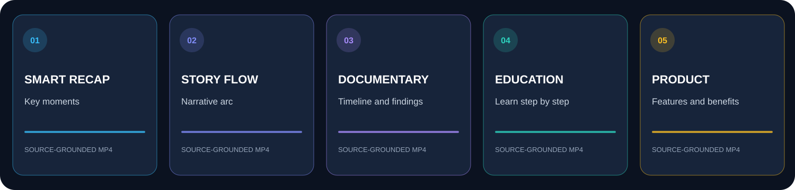
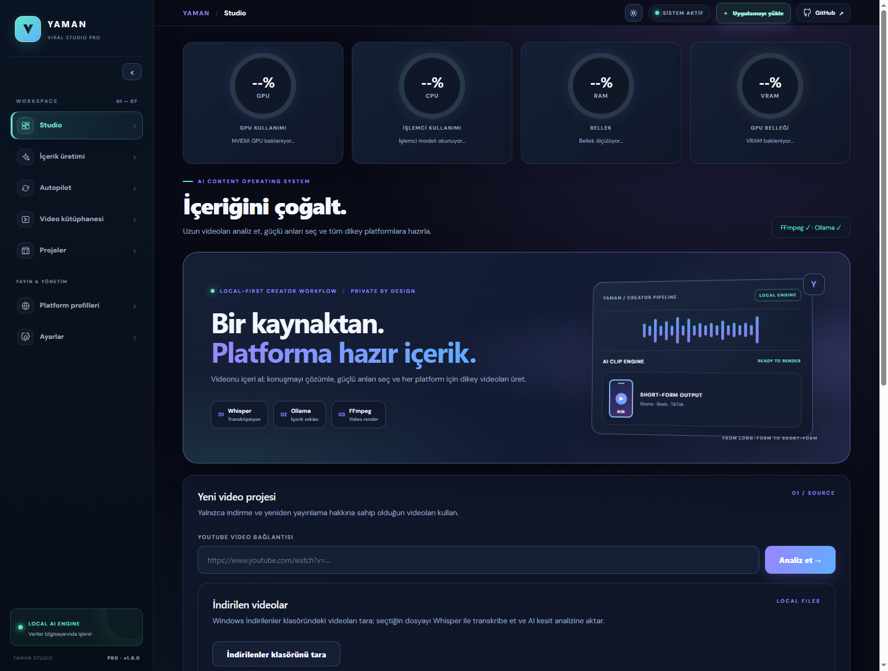
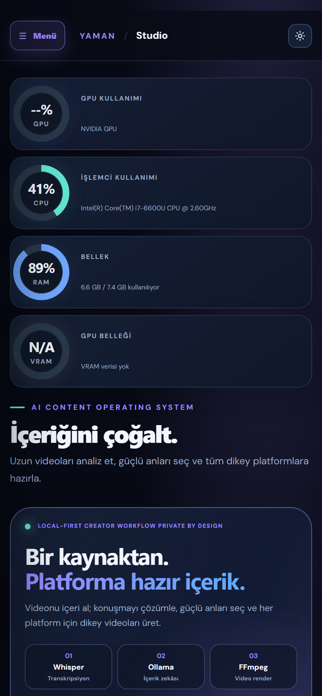
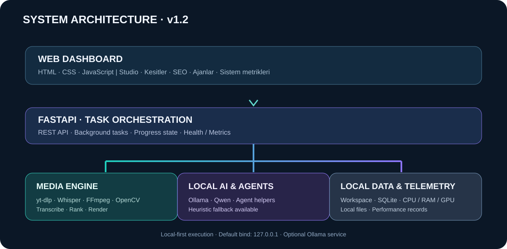

# YAMAN VIRAL STUDIO PRO

**Local-first AI video studio** for video analysis, timestamped transcription, highlight discovery and multi-format video production.

<p align="center"></p>

<p align="center">

[](CHANGELOG.md)
[](https://github.com/Myozan/YAMAN-VIRAL-STUDIO-PRO/actions/workflows/ci.yml)
[](https://www.python.org/)
[](https://fastapi.tiangolo.com/)
[](#pwa-installation)
[](LICENSE)

[ Türkçe ](README.md) · **English** · [ Deutsch ](README.de.md) · [ Español ](README.es.md)

</p>

[Social preview PNG](docs/assets/social-preview.png) · [Five-format infographic](docs/assets/video-formats.svg)

## Overview

YAMAN VIRAL STUDIO PRO turns long-form video into structured, publish-ready content. It transcribes speech, discovers strong moments and renders vertical videos with captions and editorial chapter structure.

The local-first workflow combines **Ollama**, **Faster-Whisper** and **FFmpeg** so AI analysis and media processing can run on the user's own computer. Five distinct production modes are available.

## Five production formats



| Format | Editorial structure | Output |
|---|---|---|
| **Smart Recap** | Selects key moments and creates a concise recap. | `summary_video.mp4` |
| **Story Flow** | Topic → Opening → Development → Conclusion → Closing | `story_video.mp4` |
| **Documentary Narration** | Topic → Strong Hook → Background → Timeline → Findings → Conclusion → Closing | `documentary_video.mp4` |
| **Educational Video** | Learning Goal → Introduction → Core Concepts → Step-by-Step → Example → Recap → Mini Quiz | `education_video.mp4` |
| **Product Presentation** | Need → Product → Features → Benefits → Differentiator → Evidence → CTA | `product_video.mp4` |

Each narrative format renders its own MP4 file and burns chapter titles into the video. Chapter timing is grounded in the source transcript. If local model output is incomplete or invalid, a transcript-based fallback is used.

**Grounded claims:** Product mode must not invent product features, prices, reviews, certifications, warranties or evidence that are absent from the source material.

## Live application screenshots

| Desktop | Mobile / compact |
|---|---|
|  |  |

## Product demos

- [20-second studio overview](docs/assets/showcase-demo.mp4)
- [Animated UI preview](docs/assets/showcase-demo.gif)
- [End-to-end Shorts output](docs/assets/demo-output-youtube-shorts.mp4)
- [Demo source video](docs/assets/demo-input.mp4)
- [Timestamped subtitles](docs/assets/demo-transcript.srt)
- [Demo report](docs/DEMO.md)

Demo media is synthetic test content, not personal or third-party footage.

## Automatic editing studio

Smart Recap and Documentary do more than summarize text. They select important transcript moments with source timestamps, cut the selected ranges, convert them to vertical 1080?1920 video and merge them into one MP4.

Home-screen editing controls:
- **Transitions:** Soft fade in/out (default) or clean cuts.
- **Captions:** Burn source-transcript captions into the video.
- **Chapter titles:** Add documentary/story/lesson/product chapter labels and opening/closing titles.
- **Automatic edit:** Moment selection, trimming, ordering, joining and MP4 export in one workflow.

When local AI output is invalid, transcript-based salience scoring selects moments across the source timeline. No unsupported footage or product claims are fabricated. Mobile editing controls use a responsive compact layout.

## Core capabilities

- Local video import and supported YouTube sources.
- Timestamped speech transcription with Faster-Whisper.
- Local LLM analysis through Ollama.
- Highlight discovery and short-form clip candidates.
- Vertical MP4 rendering, subtitles, chapter overlays and format-specific exports.
- Specialist AI agents for strategy, hooks, editing, SEO, safety, accessibility and localization.
- SQLite task history, event logs, cancellation, retries and recovery.
- User-approved publishing preparation for YouTube, TikTok and Instagram.
- GPU, CPU, RAM and VRAM telemetry.
- Responsive desktop/mobile web UI and installable PWA.
- Turkish, English, German and Spanish interface.

## Local Autopilot

Autopilot watches the Windows Downloads folder on a daily or weekly schedule, transcribes new videos with Whisper, ranks clips with the local AI pipeline and renders the top three clips for YouTube Shorts, Instagram Reels and TikTok. Schedules and run history are stored in SQLite and survive restarts.

Publishing is intentionally manual: every generated MP4 waits for user review and the existing explicit publishing confirmation. This release does not yet include trend discovery, text-to-video, voice cloning or unattended social posting.

## Architecture



| Layer | Technology |
|---|---|
| API and application | Python 3.12, FastAPI |
| Web interface | HTML, CSS, JavaScript |
| Local LLM | Ollama |
| Speech recognition | Faster-Whisper |
| Media processing | FFmpeg |
| Task history | SQLite |
| Installable shell | Web App Manifest, Service Worker |

## Windows setup

Requirements: Windows 10/11, Python 3.12 recommended, FFmpeg on PATH, and Ollama for local LLM features.

```powershell
git clone https://github.com/Myozan/YAMAN-VIRAL-STUDIO-PRO.git
cd YAMAN-VIRAL-STUDIO-PRO
py -3.12 -m venv .venv
.\.venv\Scripts\Activate.ps1
python -m pip install --upgrade pip
pip install -r requirements.txt
Copy-Item .env.example .env
.\run_windows.bat
```

Open **http://127.0.0.1:8765**.

Ollama and Whisper models may be downloaded on first use. Once configured, local workflows can run offline; OAuth and platform publishing integrations still require connectivity.

## PWA installation

Install from Chrome or Edge over HTTPS or localhost. On iOS, use Safari → Share → Add to Home Screen. Offline caching covers the app shell only; the backend and local AI services must remain available for processing. The Windows launcher binds to `127.0.0.1` by default.

## Security and privacy

- Local-first AI and media processing.
- OAuth credentials and tokens are stored in an encrypted vault.
- Never commit `.env`, `.oauth.key`, token vaults, `settings.local.json` or private workspace data.
- Publishing requires user approval and remains subject to platform policies.
- Import only media you have the right to use.

## Project structure

```text
app/                 FastAPI application, AI and media logic
web/                 Web UI, styles and client code
docs/                Architecture, integrations, demos and visuals
docs/assets/         Product visuals, screenshots and demo media
workspace/           Local workspace and generated outputs
.github/workflows/   CI workflows
run_windows.bat      Windows launcher
requirements.txt     Python dependencies
```

## Contributing and documentation

- [Contributing guide](CONTRIBUTING.md)
- [Security policy](SECURITY.md)
- [Architecture](docs/ARCHITECTURE.md)
- [Platform integrations](docs/PLATFORM-INTEGRATIONS.md)
- [AI agents research](docs/AI-AGENTS-RESEARCH.md)
- [Changelog](CHANGELOG.md)
- [Report a bug](https://github.com/Myozan/YAMAN-VIRAL-STUDIO-PRO/issues/new?template=bug_report.yml)

## License

The Community Edition source is distributed under the [MIT License](LICENSE). See [LICENSING.md](LICENSING.md) for separately licensed commercial modules.
