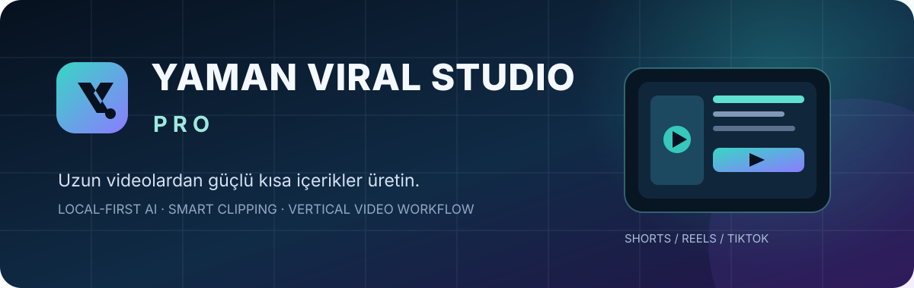
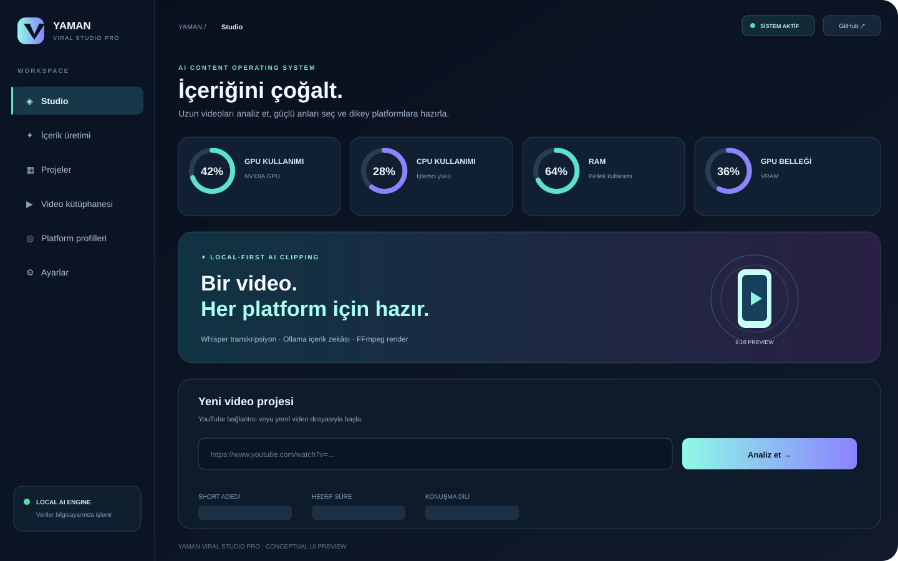
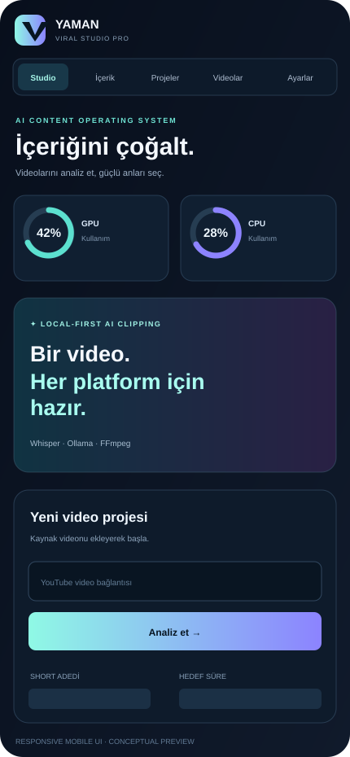

# YAMAN VIRAL STUDIO PRO

Estudio local de **reutilización de vídeo con IA** para analizar vídeos, transcribir voz y crear clips verticales para YouTube Shorts, Instagram Reels y TikTok.

<p align="center"></p>

<p align="center"><a href="https://github.com/Myozan/YAMAN-VIRAL-STUDIO-PRO/actions/workflows/ci.yml"></a>  </p>

**v1.5.2 · PWA e interfaz adaptable.** Las vistas de escritorio y móvil son ilustraciones de diseño, no capturas en directo de la aplicación.

## Funciones principales
- Importación de fuentes de YouTube autorizadas o vídeos locales de Windows.
- Transcripción con Faster-Whisper y exportación con marcas de tiempo.
- Análisis con IA local para seleccionar clips cortos.
- Renderizado vertical con subtítulos para Shorts, Reels y TikTok.
- Agentes especializados y registro persistente de tareas.
- Configuración de modelos locales de Ollama y Whisper.
- Supervisión de GPU, CPU, RAM y VRAM.

## Capturas
| Escritorio | Móvil |
|---|---|
|  |  |

## Instalación PWA

La instalación requiere HTTPS o localhost. En iOS: Safari → Compartir → Añadir a pantalla de inicio. El modo sin conexión almacena solo la interfaz; la IA, el procesamiento de vídeo y las funciones API necesitan el servidor local.

## Instalación en Windows
Requisitos: Windows 10/11, Python 3.12, FFmpeg y Ollama.

```powershell
git clone https://github.com/Myozan/YAMAN-VIRAL-STUDIO-PRO.git
cd YAMAN-VIRAL-STUDIO-PRO
ollama pull qwen3:1.7b
run_windows.bat
```

Abre http://127.0.0.1:8765. Consulta la [arquitectura](docs/ARCHITECTURE.md), las [integraciones](docs/PLATFORM-INTEGRATIONS.md) y el [registro de cambios](CHANGELOG.md).

Utiliza únicamente contenido multimedia cuyos derechos de uso y publicación tengas. La publicación mediante OAuth requiere permisos de la plataforma y confirmación explícita del usuario.
