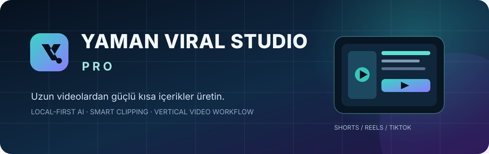
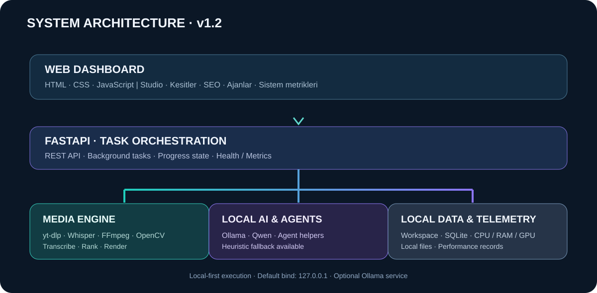
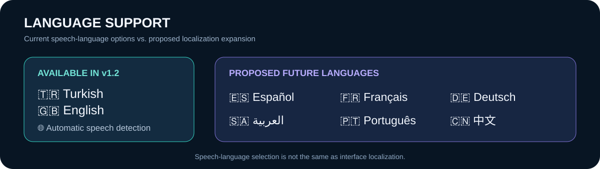

<div align="center">



# YAMAN VIRAL STUDIO PRO

### Local-first AI video production · Smart clipping · Short-form publishing workflow

[](CHANGELOG.md)
[](https://www.python.org/)
[](https://fastapi.tiangolo.com/)
[](LICENSE)
[](#-language-support--dil-desteği)

**Designed & developed by [Ozan Yaman](https://github.com/Myozan)**

[🇹🇷 Türkçe](#-türkçe) · [🇬🇧 English](#-english) · [Release notes](CHANGELOG.md) · [Roadmap](docs/ROADMAP.md)

</div>

---

## 🇹🇷 Türkçe

### Proje hakkında

**YAMAN VIRAL STUDIO PRO**, uzun video kaynaklarını analiz ederek öne çıkan anları belirlemeyi, konuşmaları zaman damgalı metne dönüştürmeyi ve kısa/dikey video içerikleri hazırlamayı amaçlayan yerel öncelikli (local-first) bir yapay zekâ destekli içerik üretim stüdyosudur.

Uygulama; video alma, konuşma çözümleme, akıllı kesit değerlendirme, altyazı ve dikey video render süreçlerini tek bir yerel web panelinde birleştirir. Hedef çıktı platformları YouTube Shorts, Instagram Reels ve TikTok'tur.

> **Sürüm notu:** Bu depo v1.2 uygulama temelini ve dokümantasyonunu içerir. README'de “planlandı” olarak belirtilen özellikler mevcut sürümde tamamlanmış kabul edilmemelidir.

### Ürün görselleri

<div align="center">

| Studio paneli | Ürün yetenek haritası |
|:--:|:--:|
|  |  |

</div>

**İçerik üretim hattı**


**Teknik mimari**



### Öne çıkan özellikler

| Modül | v1.2 durumu | Açıklama |
|---|---|---|
| Kaynak video alma | <span>Uygulandı</span> | yt-dlp ile desteklenen YouTube kaynaklarını analiz iş akışına alma |
| Konuşma çözümleme | Uygulandı | Faster-Whisper ile zaman damgalı transkripsiyon |
| Yerel AI değerlendirmesi | Uygulandı | Ollama model entegrasyonu ve sezgisel yedek puanlama |
| Akıllı kesit seçimi | Uygulandı | Aday video bölümlerini metin ve model değerlendirmesiyle sıralama |
| Dikey video render | Uygulandı | FFmpeg ile Shorts, Reels ve TikTok hedeflerine uygun çıktı |
| Altyazı | Uygulandı | Transkripsiyon verisinden altyazı üretimi ve render |
| Kadraj yardımcıları | Uygulandı | OpenCV tabanlı yüz algılama/kadraj desteği |
| İçerik metaverisi | Uygulandı | Kesitler için başlık, açıklama ve etiket önerileri |
| Ajan yardımcıları | Uygulandı | İçerik görevlerinde yardımcı ajan endpoint'leri |
| Görev takibi | Uygulandı | Analiz görev durumu ve beş aşamalı pipeline görünümü |
| Sistem izleme | Uygulandı | CPU, RAM ve desteklenen NVIDIA sistemlerinde GPU/VRAM telemetrisi |
| Yerel öğrenme kayıtları | Uygulandı | Performans gözlemlerini yerel olarak kaydetme |
| Otomatik OAuth yayınlama | Planlandı | Resmî platform API'leri, izinler ve kullanıcı onayı gerektirir |
| Kalıcı çok ajanlı orkestrasyon | Planlandı | İş akışı geçmişi, retry, iptal ve denetim olayları |
| Çok kiracılı SaaS altyapısı | Planlandı | Merkezi kullanıcı ve kurum izolasyonu |
| Değiştirilebilir çok dilli arayüz | Planlandı | Türkçe/İngilizce arayüz anahtarı ve ek yerelleştirmeler |

### Üretim akışı


1. **Kaynak:** Kullanıcı video bağlantısını girer; kaynak alma işlemi yt-dlp üzerinden yürütülür.
2. **Transkripsiyon:** Faster-Whisper konuşmayı zaman damgalarıyla metne dönüştürür.
3. **Değerlendirme:** Aday kesitler yerel Ollama modeliyle puanlanabilir. Model kullanılamıyorsa sezgisel yedek yöntem kullanılabilir.
4. **Kurgu:** FFmpeg kesitleri işler; altyazı ve dikey çıktı ayarları uygulanır. OpenCV kadraj yardımcıları kullanılabilir.
5. **Dışa aktarım:** Seçilen hedefler için yerel çıktı dosyaları oluşturulur.

### Dil desteği



| Bayrak | Dil | Kod | v1.2 durumu |
|---|---|---|---|
| 🇹🇷 | Türkçe | `tr` | Seçilebilir konuşma dili; arayüzün ana dili |
| 🇬🇧 | İngilizce | `en` | Seçilebilir konuşma dili |
| 🌐 | Otomatik algılama | `auto` | Konuşma dilini otomatik algılama |

**Gelecek dil hedefleri:** 🇪🇸 İspanyolca · 🇫🇷 Fransızca · 🇩🇪 Almanca · 🇸🇦 Arapça · 🇵🇹 Portekizce · 🇷🇺 Rusça · 🇨🇳 Çince · 🇮🇳 Hintçe.

Önemli ayrım: Konuşma dilinin seçilebilmesi, uygulama arayüzünün o dilde çevrildiği anlamına gelmez. v1.2 arayüzünün ana dili Türkçedir; tam TR/EN arayüz geçişi yol haritasındadır.

### Teknik mimari


| Katman | Teknoloji | Sorumluluk |
|---|---|---|
| Web arayüzü | HTML, CSS, JavaScript | Studio paneli, kesitler, ayarlar ve sistem metrikleri |
| API | Python, FastAPI | REST uç noktaları, görev başlatma ve durum yönetimi |
| Kaynak alma | yt-dlp | Desteklenen kaynak videoları alma |
| Konuşma tanıma | Faster-Whisper | Zaman damgalı transkripsiyon |
| Yerel dil modeli | Ollama | Kesit değerlendirme ve yapılandırılmış model yanıtları |
| Medya işleme | FFmpeg / FFprobe | Kesme, altyazı, dönüştürme ve render |
| Görüntü işleme | OpenCV | Yüz algılama ve kadraj yardımcıları |
| Yerel veri | SQLite / dosya sistemi | Öğrenme gözlemleri, iş ve medya dosyaları |

**Mimari kapsam uyarısı:** PostgreSQL, Redis, LangGraph, bulut nesne depolama, OAuth yayınlama ve gelişmiş tenant izolasyonu gibi bileşenler hedef mimari/yol haritası kapsamındadır; v1.2 yerel uygulamasının tümünde etkin oldukları varsayılmamalıdır.

### Gereksinimler

- Windows 10/11 (hazır başlatma betiği Windows içindir).
- Python 3.10 veya üzeri.
- Git.
- FFmpeg ve FFprobe, Windows PATH üzerinde erişilebilir olmalıdır.
- Ollama, yerel LLM tabanlı değerlendirme için isteğe bağlıdır.
- Whisper model dosyalarının ilk indirilmesi için internet bağlantısı gerekebilir.
- GPU hızlandırması donanım, sürücü ve Python kütüphanelerinin uyumuna bağlıdır; CPU fallback desteklenir.

### Windows kurulumu

**1. Depoyu klonlayın**

```powershell
git clone https://github.com/Myozan/YAMAN-VIRAL-STUDIO-PRO.git
cd YAMAN-VIRAL-STUDIO-PRO
git checkout import/v1.2-source
```

**2. FFmpeg'i kurun**

FFmpeg ve FFprobe'u yükleyin, `bin` dizinini PATH'e ekleyin ve yeni terminalde doğrulayın:

```powershell
ffmpeg -version
ffprobe -version
```

**3. Uygulamayı başlatın**

```powershell
.\run_windows.bat
```

Başlatma betiği sanal ortamı hazırlar, bağımlılıkları yükler ve FastAPI sunucusunu başlatır.

**Varsayılan yerel adres:** http://127.0.0.1:8765  
**API dokümantasyonu:** http://127.0.0.1:8765/docs

**4. Elle kurulum (alternatif)**

```powershell
python -m venv .venv
.\.venv\Scripts\Activate.ps1
python -m pip install --upgrade pip
pip install -r requirements.txt
python -m uvicorn app.main:app --host 127.0.0.1 --port 8765
```

PowerShell yürütme ilkesi sanal ortamı etkinleştirmeyi engelliyorsa:

```powershell
.\.venv\Scripts\python.exe -m pip install -r requirements.txt
.\.venv\Scripts\python.exe -m uvicorn app.main:app --host 127.0.0.1 --port 8765
```

> Port bilgisi: Depodaki Windows başlatma betiğinin varsayılan portu 8765'tir. Geliştirme sırasında port 8766 gibi başka bir boş porta alınabilir; tarayıcı ve API adresleri de seçilen porta göre değiştirilmelidir.

### Yerel AI ayarları

Ollama'yı [resmî Windows kurulum sayfasından](https://ollama.com/download/windows) yükleyin. Örnek:

```powershell
ollama pull qwen3:1.7b
ollama list
```

Uygulama ayarlarında Ollama adresini ve model adını belirtin. Varsayılan yerel servis adresi `http://127.0.0.1:11434` şeklindedir.

Örnek yapılandırma değişkenleri:

| Ayar | Açıklama | Örnek |
|---|---|---|
| `OLLAMA_URL` | Ollama servis adresi | `http://127.0.0.1:11434` |
| `OLLAMA_MODEL` | Yerel model | `qwen3:1.7b` |
| `WHISPER_MODEL` | Whisper model boyutu | `tiny` |
| `WHISPER_DEVICE` | Cihaz tercihi | `auto`, `cuda`, `cpu` |
| `MAX_DOWNLOAD_MB` | İndirme boyutu sınırı | `2048` |

GPU algılama, her AI veya FFmpeg işleminin GPU'da çalıştığını garanti etmez. CUDA başlatılamazsa CPU fallback davranışı yapılandırmaya bağlıdır.

### API referansı

| Metot | Endpoint | Açıklama |
|---|---|---|
| GET | `/api/health` | Uygulama ve temel bağımlılık sağlık durumu |
| GET | `/api/system/metrics` | CPU, RAM ve desteklenen GPU metrikleri |
| GET | `/api/platforms` | Platform hedefleri |
| GET | `/api/projects` | Yerel proje listesi |
| GET / POST | `/api/settings` | Ayarları okuma ve güncelleme |
| POST | `/api/analyze` | Video analiz görevi başlatma |
| GET | `/api/tasks/{task_id}` | Görev ilerlemesini sorgulama |
| GET | `/api/jobs/{job_id}` | Analiz işi ve kesit sonuçları |
| POST | `/api/render` | Seçilen kesiti render etme |
| POST | `/api/metadata` | SEO metaverisi oluşturma |
| POST | `/api/agents/run` | Yardımcı ajan görevlerini çalıştırma |
| GET | `/api/learning` | Öğrenme/performance kayıtları |
| POST | `/api/learning/record` | Performans gözlemi kaydetme |

Çalışan API şemaları için yerel Swagger arayüzü: `/docs`.

### Proje dizini

```text
YAMAN-VIRAL-STUDIO-PRO/
├── app/
│   ├── main.py
│   ├── agents.py
│   ├── framing.py
│   └── learning.py
├── docs/
│   ├── assets/
│   │   ├── hero.svg
│   │   ├── screenshot-studio.png
│   │   ├── pipeline.svg
│   │   ├── architecture.svg
│   │   ├── feature-map.svg
│   │   ├── roadmap.svg
│   │   └── language-support.svg
│   ├── ARCHITECTURE.md
│   ├── PLATFORM-INTEGRATIONS.md
│   └── ROADMAP.md
├── web/
│   ├── index.html
│   ├── app.js
│   └── style.css
├── workspace/              # Local media and generated work; do not commit
├── .env.example
├── requirements.txt
├── run_windows.bat
├── CHANGELOG.md
└── README.md
```

### Sürüm geçmişi

**v1.2 — 10 Kasım 2026**

- Yerel video analiz ve üretim hattı.
- yt-dlp, Faster-Whisper, Ollama, FFmpeg ve OpenCV entegrasyonları.
- Görev ilerleme görünümü ve Studio paneli.
- CPU/RAM ve desteklenen NVIDIA sistemlerinde GPU telemetrisi.
- Yerel ayarlar, performans kayıtları ve Windows başlatma betiği.
- Türkçe arayüz metinleri ve İngilizce konuşma seçeneği.

**11 Kasım 2026 — Dokümantasyon yenilemesi**

- Profesyonel README bilgi mimarisi ve iki dilli içerik.
- Ozan Yaman geliştirici imzası ve güncellenmiş kapak görseli.
- Özellik haritası, sürüm yol haritası ve dil desteği infografikleri.
- Ayrı sürüm geçmişi dosyası ve netleştirilmiş kurulum/API notları.

Ayrıntılar: [CHANGELOG.md](CHANGELOG.md) · [ROADMAP.md](docs/ROADMAP.md)

### Yol haritası


| Hedef sürüm | Planlanan kapsam |
|---|---|
| v1.3 | Kalıcı ajan iş akışları, retry, iptal ve denetim olayları |
| v1.4 | Platform bazlı SEO ve metaveri motoru |
| v1.5 | Yetkilendirilmiş YouTube OAuth, yükleme ve analitik |
| v1.6 | Uygun hesaplar için Instagram ve TikTok resmî API entegrasyonları |
| v1.7 | Veri güncelliği göstergeli birleşik analitik merkezi |
| v1.8 | Öğrenme, içerik takvimi, onay kuyrukları ve kontrollü otomasyon |

Bunlar planlanan kilometre taşlarıdır; yayımlanmış özellik veya taahhüt edilmiş tarih değildir.

### Güvenlik ve gizlilik

- Varsayılan sunucu adresi `127.0.0.1` olduğundan uygulama yerel makinede çalışacak şekilde tasarlanmıştır.
- Gerçek API anahtarlarını, OAuth sırlarını, parolaları veya erişim tokenlarını Git'e göndermeyin.
- `.env`, `settings.local.json`, `.venv/`, `workspace/`, yerel veritabanları ve yedekler kaynak kontrolünün dışında tutulmalıdır.
- İnternete açık dağıtım öncesinde kimlik doğrulama, TLS, erişim kontrolü, sır yönetimi, rate limiting ve denetim kayıtları eklenmelidir.
- Yalnızca kullanma ve işleme hakkına sahip olduğunuz medya dosyalarını indirin veya dönüştürün.
- Otomatik platform yayınlama, ilgili platformun resmî API erişimi, izinleri ve kullanıcı onayı gerektirir.

### Sorun giderme

- **FFmpeg bulunamadı:** FFmpeg `bin` dizinini PATH'e ekleyin ve terminali yeniden açın.
- **Ollama bağlantısı yok:** Ollama servisinin çalıştığını ve model adının doğru olduğunu kontrol edin.
- **Whisper yavaş:** Daha küçük bir model (`tiny`) deneyin; daha küçük model daha az kaynak tüketir ancak doğruluğu düşebilir.
- **GPU kullanımı görünmüyor:** NVIDIA sürücüsü, CUDA runtime ve ilgili Python paketlerinin uyumluluğunu kontrol edin. GPU telemetrisi ile modelin GPU'da çalışması aynı şey değildir.
- **RAM yetersiz:** Daha küçük Whisper/Ollama modeli seçin ve kısa kaynak videolarla test edin.
- **Port kullanımda:** Başka bir boş port seçin ve Uvicorn ile tarayıcı adresini aynı porta ayarlayın.

### Katkı

1. Depoyu fork edin.
2. Özellik veya hata düzeltmesi için ayrı dal açın.
3. Küçük ve açıklayıcı commit'ler kullanın.
4. Python/JavaScript kontrollerini ve ilgili API testlerini çalıştırın.
5. Değişiklikleri, test adımlarını ve bilinen sınırlamaları açıklayan Pull Request gönderin.

### Lisans

Bu proje [MIT Lisansı](LICENSE) ile lisanslanmıştır. Üçüncü taraf araçlar ve platform API'leri kendi lisans ve kullanım koşullarına tabidir.

---

## 🇬🇧 English

### Overview

**YAMAN VIRAL STUDIO PRO** is a local-first, AI-assisted video production studio. It analyzes long-form video sources, transcribes speech with timestamps, ranks candidate moments, and renders short-form vertical video assets for YouTube Shorts, Instagram Reels, and TikTok.

The v1.2 baseline combines source ingestion, speech transcription, local AI-assisted clip evaluation, subtitle processing, and FFmpeg rendering in a browser-based local dashboard.

### Key capabilities

- YouTube source ingestion through yt-dlp, subject to source access and platform terms.
- Timestamped speech transcription with Faster-Whisper.
- Optional local Ollama ranking with a heuristic fallback.
- Candidate clip selection and task progress tracking.
- FFmpeg-based vertical rendering and subtitle processing.
- OpenCV-assisted face detection and framing helpers.
- Platform-oriented metadata suggestions and agent utilities.
- Local learning/performance observations.
- CPU and RAM telemetry, plus NVIDIA GPU/VRAM/temperature metrics where supported.
- Windows startup script and FastAPI REST endpoints.

### Language support

| Flag | Language | Code | v1.2 status |
|---|---|---|---|
| 🇹🇷 | Turkish | `tr` | Selectable speech language; primary UI language |
| 🇬🇧 | English | `en` | Selectable speech language |
| 🌐 | Automatic detection | `auto` | Automatic spoken-language detection |

**Proposed future languages:** 🇪🇸 Spanish · 🇫🇷 French · 🇩🇪 German · 🇸🇦 Arabic · 🇵🇹 Portuguese · 🇷🇺 Russian · 🇨🇳 Chinese · 🇮🇳 Hindi.

Speech-language selection is not the same as interface localization. The v1.2 interface is primarily Turkish; a fully switchable multilingual UI is planned, not shipped.

### Quick start — Windows

Requirements: Windows 10/11, Python 3.10+, Git, FFmpeg and FFprobe. Ollama is optional.

```powershell
git clone https://github.com/Myozan/YAMAN-VIRAL-STUDIO-PRO.git
cd YAMAN-VIRAL-STUDIO-PRO
git checkout import/v1.2-source
.\run_windows.bat
```

Open **http://127.0.0.1:8765**. Interactive API documentation is available at **http://127.0.0.1:8765/docs**.

For manual installation, create a Python virtual environment, install `requirements.txt`, and run:

```powershell
python -m venv .venv
.\.venv\Scripts\Activate.ps1
pip install -r requirements.txt
python -m uvicorn app.main:app --host 127.0.0.1 --port 8765
```

### Local AI configuration

Install [Ollama](https://ollama.com/download/windows), then download a model:

```powershell
ollama pull qwen3:1.7b
ollama list
```

Configure `OLLAMA_URL`, `OLLAMA_MODEL`, `WHISPER_MODEL`, and `WHISPER_DEVICE` as required. Ollama is optional. GPU execution depends on compatible hardware, drivers, and runtime libraries; GPU detection alone does not prove that a given workload is using the GPU.

### Architecture and release documentation

- [Architecture](docs/ARCHITECTURE.md)
- [Platform integrations](docs/PLATFORM-INTEGRATIONS.md)
- [Product roadmap](docs/ROADMAP.md)
- [Release history](CHANGELOG.md)

The PostgreSQL, Redis, LangGraph, OAuth publishing, and multi-tenant architecture described in design documents represents planned evolution unless explicitly identified as implemented in the v1.2 feature matrix.

### Security

Keep credentials, tokens, local settings, virtual environments, databases, media, and generated outputs out of source control. The default development server binds to localhost. Do not expose it publicly without authentication, TLS, access control, secret management, rate limiting, and audit logging. Only process media you are authorized to use.

### Release status

- **Current documented baseline:** v1.2 (2026-11-10).
- **Documentation refresh:** 2026-11-11.
- **Future milestones:** v1.3–v1.8 are roadmap targets, not released features.

See [CHANGELOG.md](CHANGELOG.md) for shipped changes and [docs/ROADMAP.md](docs/ROADMAP.md) for planned scope.

### License

MIT. Third-party tools and platform APIs remain subject to their respective licenses and terms.

---

<div align="center">

**YAMAN VIRAL STUDIO PRO**  
Designed & developed by **Ozan Yaman**

[GitHub repository](https://github.com/Myozan/YAMAN-VIRAL-STUDIO-PRO) · [Changelog](CHANGELOG.md) · [Roadmap](docs/ROADMAP.md)

</div>
