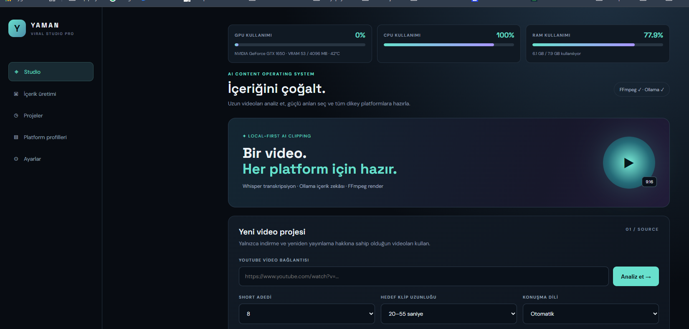

# YAMAN VIRAL STUDIO PRO

<p align="center"></p>

<p align="center"><strong>Uzun videolardan kısa, platforma hazır içerikler üretin.</strong><br/>Local-first AI · Akıllı kesit seçimi · Dikey video üretimi · İçerik operasyonları</p>

<p align="center"><a href="#türkçe">Türkçe dokümantasyon</a> · <a href="#english">English documentation</a> · <a href="docs/ROADMAP.md">Yol haritası</a></p>


**Geliştirici:** **Ozan Yaman**

[](.) [](https://www.python.org/) [](.) [](LICENSE)

**Türkçe** | [English](#english)

YAMAN VIRAL STUDIO PRO; uzun videoları analiz ederek dikkat çekici anları belirlemeyi, kısa dikey video içerikleri hazırlamayı ve YouTube Shorts, Instagram Reels ve TikTok için üretim sürecini tek bir yerel web panelinden yönetmeyi amaçlayan yapay zekâ destekli içerik üretim uygulamasıdır.

> **v1.2 notu:** Bu depo, çalışan yerel video analiz ve render uygulamasının mevcut kapsamını içerir. Yol haritasında bulunan OAuth ile otomatik yayınlama, gelişmiş çok ajanlı orkestrasyon ve merkezi çok kullanıcılı altyapı gibi özellikler, uygulanıp test edilmeden mevcut özellik olarak değerlendirilmemelidir.

## İçindekiler

- [Öne çıkan özellikler](#öne-çıkan-özellikler)
- [Video üretim akışı](#video-üretim-akışı)
- [Dil desteği ve bayraklar](#dil-desteği-ve-bayraklar)
- [Teknik mimari](#teknik-mimari)
- [Gereksinimler](#gereksinimler)
- [Windows kurulumu](#windows-kurulumu)
- [Ayarlar ve yerel yapay zekâ](#ayarlar-ve-yerel-yapay-zekâ)
- [API uç noktaları](#api-uç-noktaları)
- [Proje dizini](#proje-dizini)
- [Sorun giderme](#sorun-giderme)
- [Güvenlik ve gizlilik](#güvenlik-ve-gizlilik)
- [Bilinen sınırlar ve yol haritası](#bilinen-sınırlar-ve-yol-haritası)
- [Katkıda bulunma](#katkıda-bulunma)
- [Lisans](#lisans)
- [English](#english)

## Sürüm kapsamı ve özellik durumu

Aşağıdaki tablo, **v1.2 kaynak kodunda bulunan işlevleri** ve henüz geliştirme planında olan hedefleri birbirinden ayırır.

| Alan | v1.2 durumu | Açıklama |
|---|---|---|
| YouTube kaynak alımı | Uygulandı | yt-dlp ile analiz için kaynak video alma |
| Whisper transkripsiyonu | Uygulandı | Zaman damgalı konuşma segmentleri; otomatik/Türkçe/İngilizce dil seçimi |
| Yerel AI kesit puanlama | Uygulandı | Ollama model entegrasyonu ve sezgisel yedek puanlama |
| Dikey video render | Uygulandı | FFmpeg ile YouTube Shorts, Instagram Reels ve TikTok hedefleri |
| Altyazı ve yüz odaklı kadraj | Uygulandı | Render akışındaki altyazı ve OpenCV yüz algılama yardımcıları |
| Kesit bazlı SEO / ajan işlemleri | Uygulandı | Panelden metaveri ve ajan endpoint çağrıları |
| Görev ilerlemesi / pipeline görünümü | Uygulandı | Analiz durumuna bağlı beş aşamalı ilerleme görünümü |
| CPU / RAM / NVIDIA GPU metrikleri | Uygulandı | Sistem API'si ve panel göstergeleri; GPU yüzdesi gerçek ölçüm değeridir |
| Yerel ayarlar ve öğrenme kayıtları | Uygulandı | Model/Whisper ayarları ve performans gözlemleri |
| Türkçe arayüz | Uygulandı | Mevcut v1.2 arayüz metinleri Türkçedir |
| Arayüzde TR/EN dil anahtarı | Planlandı | Tam çoklu dil altyapısı henüz yoktur |
| OAuth ile otomatik yayınlama | Planlandı | Platform onayları, izinler ve kullanıcı onayı gerektirir |
| Kalıcı çok ajanlı orkestrasyon | Planlandı | Gelişmiş görev grafiği, geçmiş, yeniden deneme ve denetim |
| Çok kiracılı SaaS / merkezi kullanıcı sistemi | Planlandı | Kurumsal ve çok kullanıcılı altyapı hedefi |
| Canlı platform analitiği ve takvim | Planlandı | Resmî API erişimi ve metrik uygunluğuna bağlı |

## Bu sürüme kadar yapılan güncellemeler

### v1.2 · Yerel üretim hattı ve panel iyileştirmeleri

Bu depo ve çalışma oturumunda tamamlanan başlıca geliştirmeler:

- v1.2 kaynak kodunun GitHub deposuna aktarılması ve mevcut dokümantasyonla birleştirilmesi.
- Ollama için hafif yerel model profili (`qwen3:1.7b`) ve JSON biçimli model yanıtı yapılandırması.
- Düşük bellekli Windows bilgisayarlarda daha uyumlu başlangıç için Whisper `tiny` ve CPU varsayılanlarının kullanılması.
- Yerel çalışma ayarlarının kaynak kodundan ayrılması; `settings.local.json`, sanal ortam, medya alanı ve yedeklerin Git dışında tutulması.
- Sistem metrikleri API'sinde NVIDIA GPU algılama, kullanım yüzdesi, VRAM ve sıcaklık alanlarının sunulması.
- Ön yüzde GPU göstergesinin sıfır kullanımda da görünür olması ve ölçüm alınamadığında açıklayıcı durum göstermesi.
- Beş aşamalı içerik pipeline'ının görev durumlarına bağlanması; aktif, tamamlanan ve hata durumlarının görsel olarak ayrılması.
- Analiz sonrası kesit kartlarında render, SEO metaverisi ve ajan işlemlerine erişim.
- Statik dosya cache sürümünün güncellenmesi ve Python/JavaScript/Git diff kontrollerinin çalıştırılması.
- README'nin Türkçe ve İngilizce dokümantasyonla genişletilmesi.

> **Test şeffaflığı:** Sözdizimi ve temel HTTP/API kontrollerinin başarılı olması, gerçek bir YouTube videosunun uçtan uca analiz edilip tüm platformlar için render edildiğini tek başına kanıtlamaz. Uçtan uca üretim doğrulaması gerçek kaynak video ve çıktı dosyalarıyla ayrıca yapılmalıdır. GPU'nun algılanması da her model veya render işleminin GPU üzerinde çalıştığı anlamına gelmez.

### GitHub sürüm geçmişi

| Commit | Değişiklik |
|---|---|
| `7129703` | v1.2 kaynak kodu içe aktarıldı |
| `f68c5f0` | v1.2 kaynak kodu ve depo dokümantasyonu birleştirildi |
| `ea92b40` | Yerel model, Whisper varsayılanları, GPU/pipeline ve panel iyileştirmeleri |
| `22d95a3` | Ayrıntılı Türkçe + İngilizce README |
| Bu commit | README görselleri, özellik matrisi ve güncelleme geçmişi |

## Görsel dokümantasyon

README'de kullanılan SVG çizimleri depoda sürümlenir ve GitHub üzerinde doğrudan görüntülenir:

- [Ürün kapak görseli](docs/assets/hero.svg)
- [İçerik üretim hattı](docs/assets/pipeline.svg)


### Gerçek uygulama ekranı

Aşağıdaki görüntü, çalışan v1.2 uygulamasından doğrudan alınmıştır. Studio panelinde üretim ilerlemesi ile CPU, RAM ve NVIDIA GPU metrikleri birlikte görünür.

<p align="center">
  
</p>
- [Sistem mimarisi](docs/assets/architecture.svg)

Gerçek uygulama ekran görüntüleri henüz bu dokümantasyon paketine eklenmemiştir; temsili çizimler ekran görüntüsü gibi sunulmamaktadır.

## Öne çıkan özellikler

- **Video kaynağı alma:** YouTube video bağlantısını analiz iş akışına gönderme (yt-dlp).
- **Konuşmayı metne dönüştürme:** Faster-Whisper ile zaman damgalı konuşma segmentleri oluşturma.
- **Akıllı kesit seçimi:** Aday bölümleri konuşma içeriğine ve yerel Ollama modelinin değerlendirmesine göre sıralama; model kullanılamadığında sezgisel yedek puanlama.
- **Dikey video hazırlama:** FFmpeg ile platform odaklı video varyantları oluşturma.
- **Altyazı:** Transkripsiyon segmentlerinden altyazı üretme ve videoya işleme.
- **Kadraj / yüz takibi:** Render akışında dikey kadrajı iyileştirmek için OpenCV tabanlı yüz algılama desteği.
- **Platform odaklı çıktı:** YouTube Shorts, Instagram Reels ve TikTok için ayrı render hedefleri.
- **SEO metaverisi:** Kesitler için platforma göre başlık, açıklama ve etiket önerileri oluşturma.
- **Ajan araçları:** İçerik görevlerinde yardımcı ajan işlevlerini çalıştırma.
- **Öğrenme kayıtları:** Görüntülenme, beğeni, yorum, paylaşım ve izlenme süresi verilerini kaydedip temel performans içgörüleri üretme.
- **Sistem izleme:** CPU, RAM ve desteklenen NVIDIA sistemlerinde GPU/VRAM metriklerini görüntüleme.
- **Yerel çalışma:** Web panelini varsayılan olarak `127.0.0.1` üzerinde çalıştırma; Ollama ve Whisper işlemlerini yerel makinede kullanabilme.

## Video üretim akışı

<p align="center"></p>


1. **Kaynak:** YouTube video bağlantısı girilir ve analiz isteği oluşturulur.
2. **Transkripsiyon:** Faster-Whisper konuşmayı zaman damgalarıyla metne dönüştürür.
3. **Akıllı seçim:** Aday kesitler değerlendirilir ve puanlanır. Ollama yapılandırılmışsa yerel model kullanılabilir; aksi durumda sezgisel yöntem devreye girebilir.
4. **Kurgu:** Seçilen kesitler FFmpeg ile işlenir; altyazı ve dikey kadraj seçenekleri uygulanır.
5. **Dışa aktarım:** Seçilen platformlar için çıktı dosyaları hazırlanır.

İşlemlerin ilerlemesi görev durumları üzerinden izlenir. Kaynak videolar ve üretilen dosyalar yerel `workspace/` dizininde tutulur; bu dizin Git'e gönderilmez.

## Dil desteği ve bayraklar

v1.2 sürümünde kullanıcı tarafından seçilebilen konuşma dilleri:

| Bayrak | Dil | Kod | v1.2 durumu |
|---|---|---|---|
| 🇹🇷 | Türkçe | tr | Konuşma dili olarak seçilebilir; arayüzün ana dili |
| 🇬🇧 | İngilizce | en | Konuşma dili olarak seçilebilir |
| 🌐 | Otomatik algılama | auto | Konuşma dilini otomatik belirleme |

**Gelecek çoklu dil hedefleri:** 🇪🇸 İspanyolca · 🇮🇳 Hintçe · 🇸🇦 Arapça · 🇫🇷 Fransızca · 🇩🇪 Almanca · 🇵🇹 Portekizce · 🇷🇺 Rusça · 🇨🇳 Çince. Bunlar mevcut v1.2 arayüzünde ayrı seçimler değildir; gelecek çoklu dil desteği için önerilen hedeflerdir.

> Konuşma dili seçimi ile uygulama arayüzü dili farklıdır. v1.2 arayüzü Türkçedir; tam TR/EN arayüz geçişi henüz uygulanmamıştır.
## Teknik mimari

<p align="center"></p>


| Katman | Teknoloji | Sorumluluk |
|---|---|---|
| Web arayüzü | HTML, CSS, JavaScript | Studio paneli, analiz, kesitler, ayarlar ve sistem metrikleri |
| API | Python, FastAPI | İstek doğrulama, görev başlatma, durum ve sonuç uç noktaları |
| Video indirme | yt-dlp | Desteklenen kaynaklardan video alma |
| Konuşma tanıma | Faster-Whisper | Zaman damgalı transkripsiyon |
| Yerel dil modeli | Ollama | Aday kesitlerin yerel modelle değerlendirilmesi ve yapılandırılmış yanıtlar |
| Video işleme | FFmpeg / FFprobe | Kesme, dönüştürme, altyazı ve çıktı üretimi |
| Görüntü işleme | OpenCV | Kadraj ve yüz algılama yardımcıları |
| Öğrenme verisi | Yerel SQLite | Performans kayıtları ve öğrenme gözlemleri |

### Mimari belgeler

- [Sistem mimarisi](docs/ARCHITECTURE.md)
- [Platform entegrasyon planı](docs/PLATFORM-INTEGRATIONS.md)
- [Ürün yol haritası](docs/ROADMAP.md)

**Mimari not:** Belgelerde tarif edilen PostgreSQL, Redis, LangGraph, nesne depolama ve OAuth tabanlı yayınlama gibi bazı bileşenler hedef mimari/yol haritası kapsamındadır. Bunların tümü v1.2 yerel uygulamasında etkin değildir.

## Gereksinimler

- Windows 10/11 (kurulum betiği Windows içindir).
- Python 3.10 veya üzeri.
- Git (kaynak kodunu almak ve güncellemek için).
- FFmpeg ve FFprobe; ikisi de `PATH` üzerinden erişilebilir olmalıdır.
- Ollama (yerel model tabanlı değerlendirme için isteğe bağlı).
- Transkripsiyon modeli için ilk indirmede internet bağlantısı ve yeterli disk alanı.
- Video işleme ve Whisper için yeterli RAM/CPU; GPU kullanımı donanım, sürücü ve kütüphane uyumluluğuna bağlıdır.

## Windows kurulumu

### 1. Depoyu klonlayın

```powershell
git clone https://github.com/Myozan/YAMAN-VIRAL-STUDIO-PRO.git
cd YAMAN-VIRAL-STUDIO-PRO
```

Çalıştırmak istediğiniz dalı seçin:

```powershell
git checkout import/v1.2-source
```

### 2. FFmpeg kurun

FFmpeg ve FFprobe'u kurup `bin` dizinini Windows `PATH` değişkenine ekleyin. Yeni bir terminal açtıktan sonra doğrulayın:

```powershell
ffmpeg -version
ffprobe -version
```

### 3. Uygulamayı başlatın

Proje kök dizininde:

```powershell
.\run_windows.bat
```

Betik sanal ortamı oluşturur, `requirements.txt` bağımlılıklarını yükler ve FastAPI sunucusunu başlatır. Ardından tarayıcıdan şu adresi açın:

**http://127.0.0.1:8765**

### 4. Elle kurulum (alternatif)

```powershell
python -m venv .venv
.\.venv\Scripts\Activate.ps1
python -m pip install --upgrade pip
pip install -r requirements.txt
python -m uvicorn app.main:app --host 127.0.0.1 --port 8765
```

PowerShell betik çalıştırma ilkesi sanal ortamı etkinleştirmeyi engellerse, etkinleştirme adımını atlayıp sanal ortamdaki Python'u doğrudan kullanabilirsiniz:

```powershell
.\.venv\Scripts\python.exe -m pip install -r requirements.txt
.\.venv\Scripts\python.exe -m uvicorn app.main:app --host 127.0.0.1 --port 8765
```

## Ayarlar ve yerel yapay zekâ

### Ollama

Ollama'yı [resmî Windows indirme sayfasından](https://ollama.com/download/windows) kurun. Örnek model indirme:

```powershell
ollama pull qwen3:1.7b
ollama list
```

Uygulama ayarlarında Ollama adresi ve model adını yapılandırın. Yerel servis varsayılan olarak `http://127.0.0.1:11434` adresindedir. Model kullanılamazsa kesit puanlaması sezgisel yedek yönteme düşebilir.

### Ortam değişkenleri

`.env.example` dosyası örnek ayarları gösterir. İhtiyaç halinde `.env` dosyası oluşturabilirsiniz:

| Değişken | Açıklama | Örnek |
|---|---|---|
| `OLLAMA_URL` | Ollama servis adresi | `http://127.0.0.1:11434` |
| `OLLAMA_MODEL` | Kullanılacak model | `qwen3:1.7b` |
| `WHISPER_MODEL` | Whisper model boyutu | `tiny` |
| `WHISPER_DEVICE` | Transkripsiyon cihaz tercihi | `cpu` |
| `MAX_DOWNLOAD_MB` | İndirme boyutu sınırı | `2048` |

Donanımınız desteklemiyorsa Whisper için CUDA/GPU kullanımını zorlamayın; CPU seçeneği daha uyumlu olabilir ancak daha yavaştır. NVIDIA GPU algılanması, her işin GPU üzerinde çalıştığı anlamına gelmez.

## API uç noktaları

Yerel API'nin temel uç noktaları:

| Metot | Yol | Açıklama |
|---|---|---|
| `GET` | `/api/health` | Uygulama ve temel bağımlılık sağlık durumu |
| `GET` | `/api/system/metrics` | CPU, RAM ve desteklenen GPU metrikleri |
| `GET` | `/api/platforms` | Platform hedefleri |
| `GET` | `/api/projects` | Yerel proje listesi |
| `GET` | `/api/settings` | Mevcut uygulama ayarları |
| `POST` | `/api/settings` | Ayarları güncelleme |
| `POST` | `/api/analyze` | Video analiz görevi başlatma |
| `GET` | `/api/tasks/{task_id}` | Görev ilerlemesini sorgulama |
| `GET` | `/api/jobs/{job_id}` | Analiz işi ve kesit sonuçlarını alma |
| `POST` | `/api/render` | Seçilen kesiti platform hedefleri için işleme |
| `POST` | `/api/metadata` | Platforma göre SEO metaverisi oluşturma |
| `POST` | `/api/agents/run` | Ajan görevlerini çalıştırma |
| `GET` | `/api/learning` | Öğrenme/performance içgörüleri |
| `POST` | `/api/learning/record` | Performans verisi kaydetme |

Geliştirme ve entegrasyon sırasında FastAPI şemalarını `/docs` adresinden inceleyebilirsiniz: **http://127.0.0.1:8765/docs**.

## Proje dizini

```text
YAMAN-VIRAL-STUDIO-PRO/
├── app/
│   ├── main.py          # FastAPI uygulaması ve medya iş akışları
│   ├── agents.py        # Ajan yardımcıları
│   ├── framing.py       # Kadraj yardımcıları
│   └── learning.py      # Performans/öğrenme mantığı
├── docs/
│   ├── ARCHITECTURE.md
│   ├── PLATFORM-INTEGRATIONS.md
│   └── ROADMAP.md
├── web/
│   ├── index.html       # Web arayüzü
│   ├── app.js           # İstemci tarafı davranışları
│   └── style.css        # Arayüz stilleri
├── workspace/           # Yerel medya ve iş verileri (Git'e eklenmez)
├── .env.example         # Örnek ortam değişkenleri
├── requirements.txt     # Python bağımlılıkları
├── run_windows.bat      # Windows başlatma betiği
└── README.md
```

## Sorun giderme

- **`ffmpeg` veya `ffprobe` bulunamadı:** FFmpeg `bin` dizinini `PATH` içine ekleyin ve terminali yeniden açın.
- **Ollama bağlantısı yok:** Ollama uygulamasının çalıştığını, `ollama list` çıktısını ve model adının ayarlarla eşleştiğini kontrol edin.
- **Whisper ilk çalıştırmada yavaş:** Model dosyaları ilk kullanımda indirilebilir; küçük `tiny` modeli daha az kaynak tüketir ancak doğruluk seviyesi daha düşük olabilir.
- **GPU kullanımı %0:** Bu değer GPU'nun o anda iş yükü almadığını gösterebilir. GPU'nun algılanması, Whisper veya FFmpeg işlemlerinin GPU kullandığını garanti etmez.
- **Bellek yetersizliği:** Aynı anda çalışan ağır uygulamaları azaltın, daha küçük Whisper/Ollama modeli seçin ve kısa bir kaynak video ile deneyin.
- **Port dolu:** `8765` portunu kullanan işlemi kontrol edin veya Uvicorn portunu değiştirin; tarayıcı adresini de buna göre güncelleyin.
- **YouTube indirme hatası:** Video erişim izinlerini, yaş/bölge kısıtlarını, yt-dlp sürümünü ve platform koşullarını kontrol edin.

## Güvenlik ve gizlilik

- Uygulama başlatma betiği sunucuyu varsayılan olarak `127.0.0.1` adresine bağlar. Bu, yerel makine dışından doğrudan erişimi engeller.
- Gerçek API anahtarlarını, OAuth sırlarını, erişim/yenileme tokenlarını, parolaları veya özel anahtarları Git'e eklemeyin.
- `.env`, `settings.local.json`, `.venv/`, `workspace/`, yerel veritabanları ve yedek dosyalar kaynak kontrolünün dışında tutulmalıdır.
- Yalnızca indirme, dönüştürme ve yeniden kullanma hakkına sahip olduğunuz medya üzerinde işlem yapın. Platformların hizmet koşullarına ve telif haklarına uyun.
- Yerel ağda veya internette yayınlamadan önce kimlik doğrulama, TLS, erişim kontrolü, güvenli sır yönetimi, istek sınırlandırma ve denetim kayıtları ekleyin. Bu depo, internete açık üretim dağıtımı için hazır bir güvenlik katmanı sunduğunu iddia etmez.
- Platformlara otomatik yayınlama, ilgili platformun resmî API erişimi, izinleri, hesap uygunluğu ve kullanıcı onayı gerektirir.

## Bilinen sınırlar ve yol haritası

v1.2, yerel analiz ve render odaklı bir sürümdür. Aşağıdaki konular yol haritasında tanımlanmıştır ve mevcut sürümde tamamlanmış oldukları varsayılmamalıdır:

- Gelişmiş, kalıcı ve yeniden başlatılabilir çok ajanlı iş akışı orkestrasyonu.
- Kullanıcı/kurum bazlı çok kiracılı hesap sistemi ve merkezi veritabanı.
- YouTube, Instagram ve TikTok için üretim seviyesinde OAuth bağlantısı ve resmî API üzerinden otomatik yayınlama.
- Yayın takvimi, onay mekanizması, gelişmiş canlı analitik ve kapsamlı denetim kayıtları.
- Arayüz için Türkçe/İngilizce arasında değiştirilebilir çoklu dil sistemi.

Güncel plan ve kabul kriterleri için [ROADMAP.md](docs/ROADMAP.md) dosyasına bakın.

## Katkıda bulunma

1. Depoyu fork edin.
2. Özellik veya hata düzeltmesi için ayrı bir dal açın.
3. Değişikliği küçük ve açıklayıcı commit'lerle yapın.
4. Python ve JavaScript sözdizimi kontrollerini çalıştırın; ilgili API akışlarını test edin.
5. Değişikliğin kapsamını, test adımlarını ve bilinen sınırlarını açıklayan bir Pull Request gönderin.

Güvenlik açığı bildirimlerinde hassas ayrıntıları herkese açık issue olarak paylaşmayın; depo sahibine özel kanaldan ulaşın.

## Lisans

Bu proje [MIT Lisansı](LICENSE) ile lisanslanmıştır. Üçüncü taraf araçlar ve platform API'leri kendi lisans ve kullanım koşullarına tabidir.

---

## English

<p align="center"></p>


**Developer: Ozan Yaman**

YAMAN VIRAL STUDIO PRO is an AI-assisted, local-first video content production application. It analyzes long-form video sources, transcribes speech, ranks candidate moments, and prepares short-form vertical video outputs for YouTube Shorts, Instagram Reels, and TikTok.

### Key capabilities

- YouTube source ingestion through yt-dlp, subject to source access and platform terms.
- Timestamped speech transcription with Faster-Whisper.
- Candidate clip ranking with a local Ollama model and a heuristic fallback.
- FFmpeg-based clip rendering, subtitle generation, and vertical output variants.
- OpenCV-assisted face detection and framing helpers.
- Platform-oriented metadata suggestions and agent utilities.
- Local performance observations and system metrics for CPU, memory, and supported NVIDIA GPUs.
- A browser-based dashboard served locally by FastAPI.

### Language support and flags

| Flag | Language | Code | v1.2 status |
|---|---|---|---|
| 🇹🇷 | Turkish | tr | Selectable speech language; primary interface language |
| 🇬🇧 | English | en | Selectable speech language |
| 🌐 | Automatic detection | auto | Detects spoken language automatically |

**Future multilingual targets:** 🇪🇸 Spanish · 🇮🇳 Hindi · 🇸🇦 Arabic · 🇫🇷 French · 🇩🇪 German · 🇵🇹 Portuguese · 🇷🇺 Russian · 🇨🇳 Chinese. These are proposed expansion targets, not separate v1.2 UI selections.

Speech-language selection is distinct from UI localization. The v1.2 interface is Turkish; a fully switchable Turkish/English UI is not implemented yet.

### Quick start (Windows)

1. Install Python 3.10+, Git, FFmpeg and FFprobe. Install Ollama if local LLM ranking is desired.
2. Clone the repository and select the v1.2 branch:

```powershell
git clone https://github.com/Myozan/YAMAN-VIRAL-STUDIO-PRO.git
cd YAMAN-VIRAL-STUDIO-PRO
git checkout import/v1.2-source
```

3. Run `run_windows.bat` from the project root.
4. Open **http://127.0.0.1:8765** in your browser.

For manual setup, create and activate a Python virtual environment, install `requirements.txt`, then run:

```powershell
python -m uvicorn app.main:app --host 127.0.0.1 --port 8765
```

### Configuration

Copy `.env.example` to `.env` if environment overrides are needed. Important settings include `OLLAMA_URL`, `OLLAMA_MODEL`, `WHISPER_MODEL`, `WHISPER_DEVICE`, and `MAX_DOWNLOAD_MB`. Ollama is optional; without it, candidate ranking may use the heuristic fallback. GPU execution depends on compatible hardware, drivers, and libraries and must not be assumed from GPU detection alone.

### API and documentation

FastAPI interactive API documentation is available at `http://127.0.0.1:8765/docs`. Architecture, platform integration plans, and product milestones are documented in `docs/ARCHITECTURE.md`, `docs/PLATFORM-INTEGRATIONS.md`, and `docs/ROADMAP.md`.

### Scope and security

This release focuses on local analysis and rendering. OAuth-based publishing, production-grade multi-tenant infrastructure, advanced persistent agent orchestration, and a switchable bilingual UI are roadmap items unless explicitly implemented and verified. Keep credentials, local settings, databases, virtual environments, media files, and generated outputs out of source control. Only process media you are authorized to use, and do not expose the development server publicly without adding appropriate authentication and security controls.

### License

MIT. Third-party tools and platform APIs remain subject to their own licenses and terms.

---

<p align="center">Built for local-first creator workflows · YAMAN VIRAL STUDIO PRO</p>
