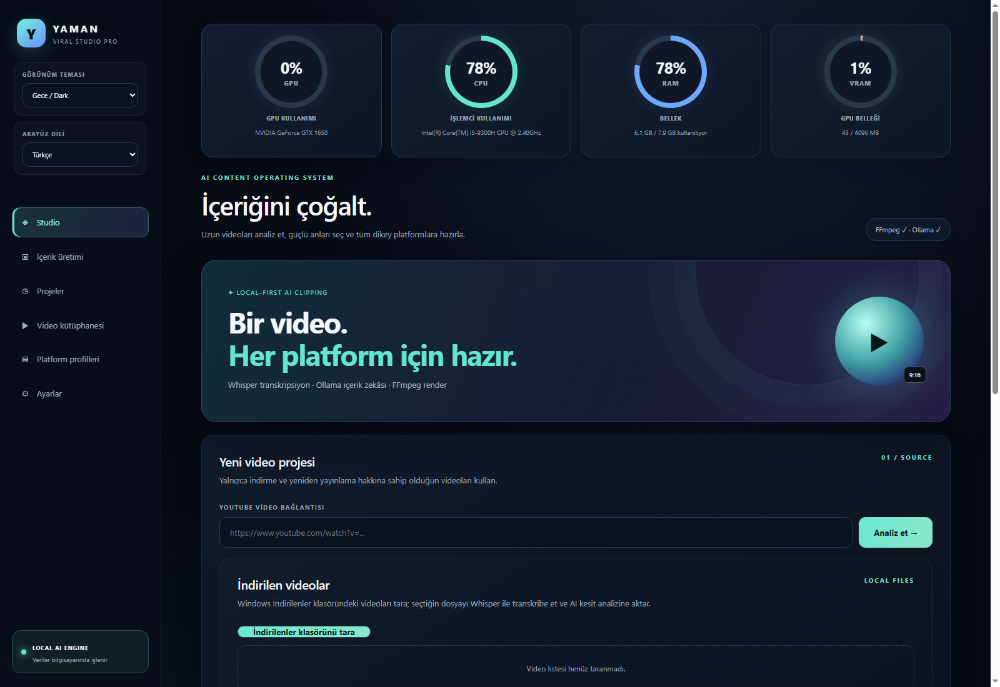
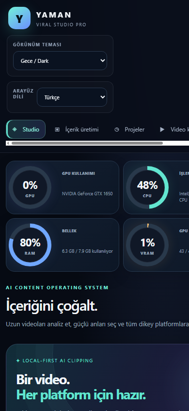
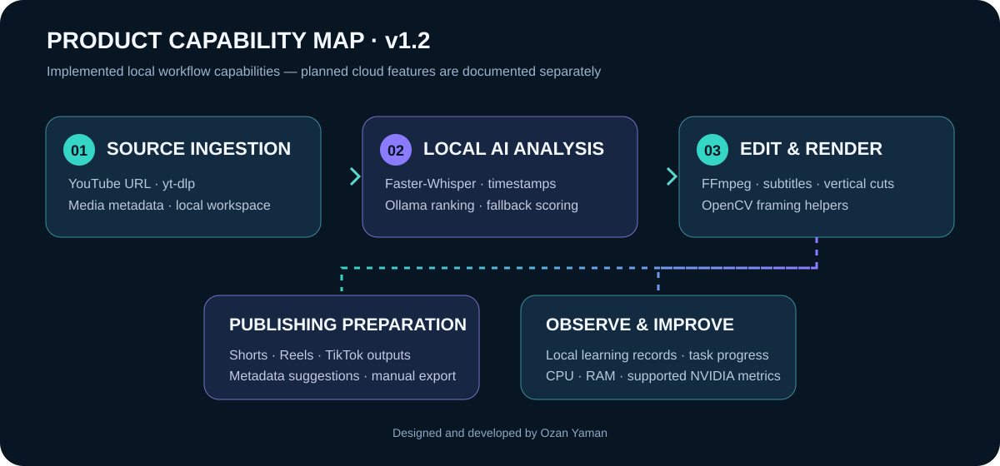
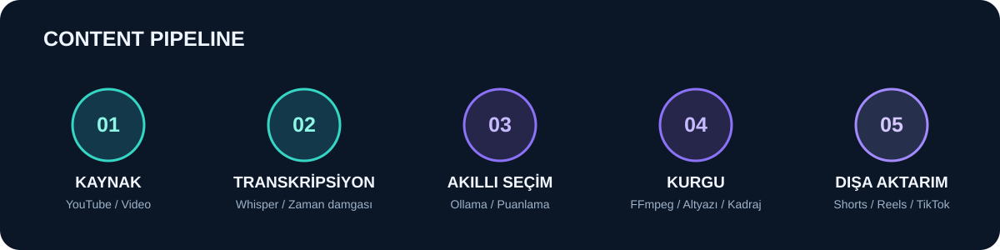
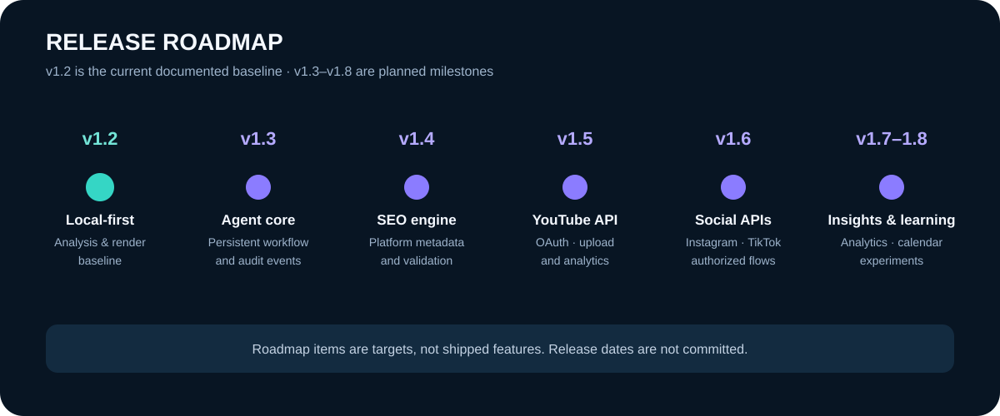

# YAMAN VIRAL STUDIO PRO

### Yerel yapay zekâ ile video analiz, Shorts üretimi ve çok platformlu içerik iş akışı

> **v1.5 Professional UI** · İkonlu gezinme, yenilenmiş marka alanı, GitHub kısayolları ve mobil çalışma alanı iyileştirmeleri.

[🇹🇷 Türkçe](README.md) · [🇬🇧 English](README.en.md) · [🇩🇪 Deutsch](README.de.md) · [🇪🇸 Español](README.es.md)

**Tasarım ve geliştirme: [Ozan Yaman](https://github.com/Myozan)**

---

## ✨ Genel bakış

YAMAN VIRAL STUDIO PRO; uzun videoları analiz eden, konuşmaları zaman damgalı metne dönüştüren, güçlü anları kısa video kesitlerine ayıran ve YouTube Shorts, Instagram Reels ile TikTok için içerik hazırlayan yerel öncelikli bir AI stüdyosudur.

Ollama, Faster-Whisper ve FFmpeg tabanlı iş akışı, içerik üretimini mümkün olduğunca kullanıcının kendi bilgisayarında tutar.

## 🖥️ Uygulamadan görüntüler

Yeni arayüz; masaüstünde sabit ikonlu yan menü, üst bağlam çubuğu ve GitHub depo erişimi sunar. Küçük ekranlarda menü yatay kaydırılabilir ve içerik alanı tek sütuna geçer.

| Masaüstü çalışma alanı | Mobil uyumlu görünüm |
|:---:|:---:|
|  |  |

## 🚀 Öne çıkan yetenekler

- **Video içe aktarma:** YouTube bağlantısı veya yerel Windows Downloads klasörü.
- **Akıllı transkripsiyon:** Faster-Whisper ile zaman damgalı konuşma metni ve TXT dışa aktarma.
- **AI kesit seçimi:** Hook, bağlam, konuşma yoğunluğu ve izlenebilirlik sinyallerine dayalı klip adayları.
- **Akıllı özet videosu:** Önemli anları birleştiren dikey MP4, altyazı, giriş ve kapanış.
- **12 uzman AI ajanı:** Strateji, hook, kurgu, SEO, risk kontrolü, erişilebilirlik, yerelleştirme ve yayın hazırlığı.
- **Görev orkestrasyonu:** SQLite tabanlı görev geçmişi, olay günlüğü, iptal, yeniden deneme ve yeniden başlatma sonrası kurtarma.
- **Çok dilli arayüz:** Türkçe, English, Deutsch ve Español; dil seçimi Ayarlar bölümünden yönetilir.
- **Platform iş akışları:** YouTube, TikTok ve Instagram için OAuth bağlantısı ve kullanıcı onaylı yayın hazırlığı.
- **Sistem izleme:** GPU, CPU, RAM ve VRAM kullanım göstergeleri.
- **Uyarlanabilir arayüz:** Masaüstü ve mobil ekranlar için duyarlı tasarım.

## 🔄 Üretim akışı

1. Kaynak videoyu içe aktar.
2. Whisper ile konuşmayı yazıya dönüştür.
3. Yerel AI ile güçlü anları ve kesitleri belirle.
4. Dikey kadraj, altyazı ve platform profilini uygula.
5. MP4 çıktısını incele ve istediğin platforma hazırla.

## 🧩 Mimari

| Katman | Teknoloji |
|---|---|
| API ve görev yönetimi | Python 3.12 · FastAPI · Uvicorn |
| Yerel dil modeli | Ollama · Qwen |
| Konuşma tanıma | Faster-Whisper |
| Video işleme | FFmpeg · FFprobe · yt-dlp |
| Web arayüzü | HTML · CSS · JavaScript |
| Kalıcı görev geçmişi | SQLite |
| OAuth gizli verileri | Fernet ile yerel şifreleme |

## ⚙️ Windows kurulumu

**Gereksinimler:** Windows 10/11, Python 3.12, FFmpeg ve Ollama.

1. Depoyu klonla: **git clone https://github.com/Myozan/YAMAN-VIRAL-STUDIO-PRO.git**
2. Proje klasörüne gir.
3. Yerel modeli indir: **ollama pull qwen3:1.7b**
4. **run_windows.bat** dosyasını çalıştır.
5. Tarayıcıda **http://127.0.0.1:8765** adresini aç.

Bağımlılıkları elle kurmak için Python sanal ortamı oluşturup **pip install -r requirements.txt** komutunu çalıştır.

## 📲 Ana ekrana yükleme (PWA)

YAMAN VIRAL STUDIO PRO, desteklenen tarayıcılarda ana ekrana yüklenebilir.

1. Uygulamayı aynı cihazda `http://127.0.0.1:8765` üzerinden aç veya telefonda erişilebilen güvenilir bir HTTPS adresi kullan.
2. Desteklenen Chromium tarayıcılarında üst çubuktaki **Uygulamayı yükle** düğmesine bas. Alternatif olarak tarayıcı menüsündeki **Uygulamayı yükle** seçeneğini kullan.
3. iPhone/iPad'de Safari paylaş menüsünü aç ve **Ana Ekrana Ekle** seçeneğini seç.
4. Windows masaüstünde Edge/Chrome adres çubuğundaki yükleme simgesini de kullanabilirsin.

**Önemli sınırlar:**
- PWA kurulumu ve Service Worker için HTTPS veya localhost gerekir. Telefon, bilgisayardaki `127.0.0.1` adresine erişemez; telefon üzerinden kullanım için güvenilir HTTPS dağıtımı gerekir.
- Windows başlatıcısı güvenlik nedeniyle varsayılan olarak yalnızca `127.0.0.1` üzerinde dinler. LAN'a otomatik açılmaz.
- Çevrimdışı önbellek yalnızca uygulama kabuğunu (arayüz, CSS, JavaScript ve ikonlar) tutar. Video analizi, AI, OAuth, yükleme ve diğer API işlemleri için YAMAN sunucusu ve yerel servisler çalışır durumda olmalıdır.
- API yanıtları ve özel `/workspace` dosyaları Service Worker önbelleğine alınmaz.

## 🌐 Dil ve görünüm ayarları

Uygulama içinden **Ayarlar → Dil ve yerelleştirme** bölümüne git. Türkçe, English, Deutsch veya Español seçimini yap. Tercih tarayıcıda saklanır ve sonraki açılışta korunur. Görünüm teması ayrıca Gece, Açık ve Okyanus seçenekleriyle değiştirilebilir.

## 🔐 OAuth ve yayınlama

Platform Profilleri bölümünde sağlayıcı geliştirici bilgilerini tanımla. Uygulama kimlik bilgileri ve tokenlar yerel diskte şifrelenir.

| Platform | Gerekli yapılandırma | İzin |
|---|---|---|
| YouTube | YAMAN_GOOGLE_CLIENT_ID / YAMAN_GOOGLE_CLIENT_SECRET | youtube.upload |
| TikTok | YAMAN_TIKTOK_CLIENT_KEY / YAMAN_TIKTOK_CLIENT_SECRET | video.publish |
| Instagram | YAMAN_META_APP_ID / YAMAN_META_APP_SECRET | instagram_basic, instagram_content_publish, pages_show_list |

OAuth callback adresini ilgili geliştirici konsoluna birebir ekle. Her yayın işlemi kullanıcı onayı ister. YouTube yüklemeleri varsayılan olarak private başlar; TikTok uygulama denetimi ve Instagram'ın HTTPS medya adresi gereksinimleri platform kurallarına tabidir.

## 🛡️ Güvenlik ve gizlilik

- AI ve video işleme adımları yerel servislerle çalışacak şekilde tasarlanmıştır.
- OAuth sırları ve erişim tokenları Fernet ile şifrelenir.
- .oauth.key, token kasası, settings.local.json ve çalışma alanı verileri Git'e eklenmemelidir.
- .oauth.key dosyasını güvenli bir yerde yedekle; kaybolması şifreli token kasasının açılamamasına neden olur.
- Yalnızca kullanma ve yeniden yayınlama hakkına sahip olduğun içerikleri içe aktar.

## 🗂️ Proje yapısı

- **app/** — FastAPI uygulaması ve AI/video iş mantığı
- **web/** — Web arayüzü, stiller ve istemci kodu
- **docs/** — Mimari, entegrasyon ve görsel dokümantasyon
- **workspace/** — Yerel çalışma çıktıları (Git dışında tutulur)
- **run_windows.bat** — Windows başlatıcısı
- **requirements.txt** — Python bağımlılıkları

## 🧭 Yol haritası

## 📚 Teknik dokümantasyon

- [AI ajanları ve OAuth araştırması](docs/AI-AGENTS-RESEARCH.md)
- [Mimari notları](docs/ARCHITECTURE.md)
- [Platform entegrasyonları](docs/PLATFORM-INTEGRATIONS.md)
- [Sürüm geçmişi](CHANGELOG.md)

## 📄 Lisanslama

- **Community Edition:** Depodaki mevcut kaynak kodu [MIT Lisansı](LICENSE) kapsamındadır. Ticari kullanım dahil MIT hakları korunur.
- **Enterprise / Commercial:** Yalnızca ayrıca tanımlanmış ticari modüller, imzalı kurumsal sözleşme ile lisanslanır. Mevcut MIT kodunun hakları daraltılmaz.
- [Lisanslama modeli ve bileşen sınırları](LICENSING.md)
- [Ticari lisans sözleşmesi taslağı](LICENSE-COMMERCIAL-TEMPLATE.md) — yalnızca taslaktır; imzalı sözleşme ve hukuk incelemesi olmadan lisans vermez.

**YAMAN VIRAL STUDIO PRO** · Built with focus by [Ozan Yaman](https://github.com/Myozan)

