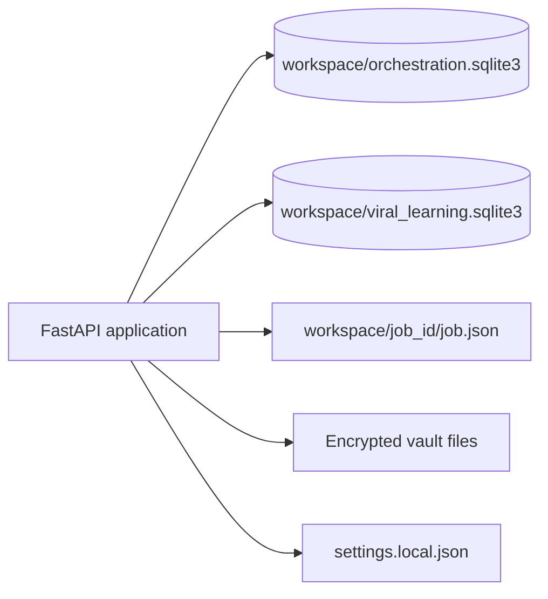
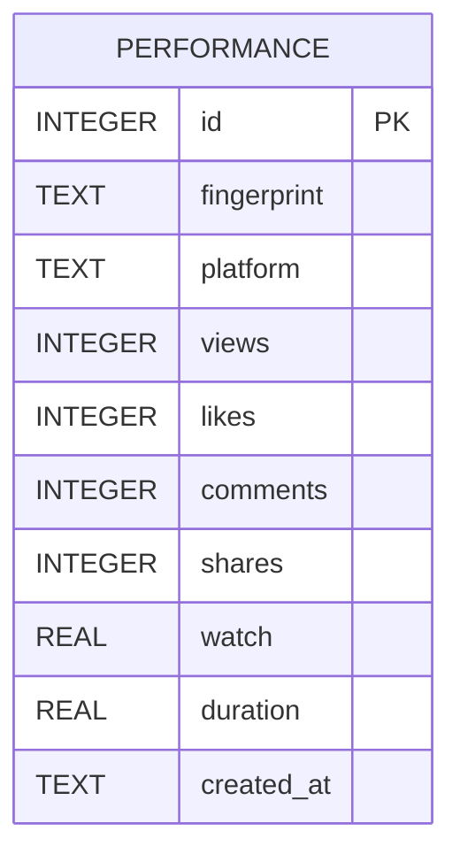
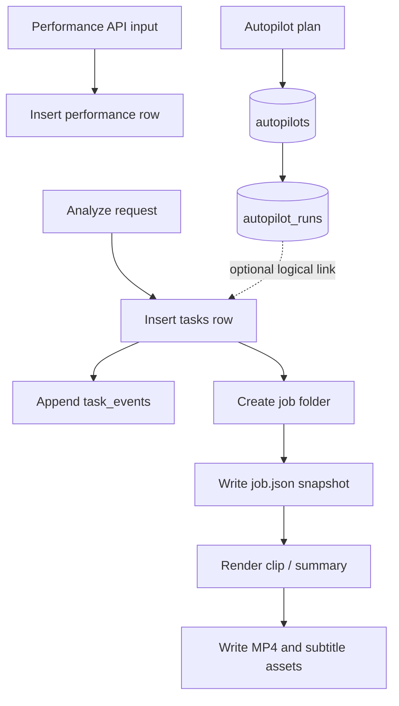

# Database ERD — v1.8.0

This document records the SQLite structures found in the current source code. The diagram shows logical references; the inspected schema does not declare SQL foreign-key constraints for these relationships.

## 1. Database topology



## 2. Orchestration ERD

```mermaid
erDiagram
  TASKS {
    TEXT task_id PK
    TEXT created_at
    TEXT updated_at
    TEXT status
    INTEGER percent
    TEXT stage
    TEXT payload_json
  }
  TASK_EVENTS {
    INTEGER id PK
    TEXT task_id FK_LOGICAL
    TEXT event_type
    TEXT created_at
    TEXT payload_json
  }
  AUTOPILOTS {
    TEXT id PK
    TEXT name
    TEXT niche
    TEXT language
    INTEGER clips
    INTEGER min_seconds
    INTEGER max_seconds
    TEXT platforms_json
    TEXT frequency
    TEXT publish_time
    TEXT timezone
    INTEGER enabled
    TEXT next_run
    TEXT last_run
    TEXT last_status
    TEXT last_message
    TEXT processed_json
    TEXT created_at
    TEXT updated_at
  }
  AUTOPILOT_RUNS {
    TEXT id PK
    TEXT autopilot_id FK_LOGICAL
    TEXT started_at
    TEXT finished_at
    TEXT status
    TEXT message
    TEXT task_id
    TEXT job_id
    TEXT output_json
  }
  OAUTH_STATES {
    TEXT state PK
    TEXT platform
    TEXT verifier
    TEXT redirect_uri
    REAL created_at
  }
  TASKS ||--o{ TASK_EVENTS : "logical task_id"
  AUTOPILOTS ||--o{ AUTOPILOT_RUNS : "logical autopilot_id"
  TASKS o|--o{ AUTOPILOT_RUNS : "optional task_id reference"
```

## 3. Learning database ERD



The learning engine groups observations by platform. Its adjustment helper returns zero until a platform has at least three observations. It is a simple heuristic, not a trained predictive model.

## 4. Filesystem-backed records

| Path | Contents | Relational? |
|---|---|---|
| `workspace/{job_id}/job.json` | Job metadata, transcript segments, clips, source video path | No |
| `workspace/{job_id}/` | Source and generated media | No |
| `workspace/oauth_tokens.enc` | Encrypted OAuth token data | No |
| `workspace/oauth_apps.enc` | Encrypted OAuth app credentials | No |
| `workspace/visual_providers.enc` | Encrypted visual provider keys | No |
| `settings.local.json` | Local Ollama/Whisper settings | No |
| `.oauth.key` | Fernet key file (default path) | No |

## 5. Data lifecycle



## 6. Consistency and backup

- Stop the application before copying both SQLite files using a simple file copy.
- Prefer SQLite's online backup API or a controlled snapshot if a live backup mechanism is introduced.
- Back up the workspace, local settings and encryption key as one coordinated set.
- Encrypt backups and restrict access: workspace may contain personal media, tokens and generated outputs.
- Restore into an isolated location first; verify database integrity, job files, media paths and vault decryption.
- Never commit SQLite databases, private media, vaults or key files to Git.

## 7. Migration notes

Before migrating to PostgreSQL, define explicit foreign keys, indexes, transaction boundaries, migration versioning and ownership columns. Do not infer that JSON payload columns or filesystem paths can be migrated safely without a data migration plan.
