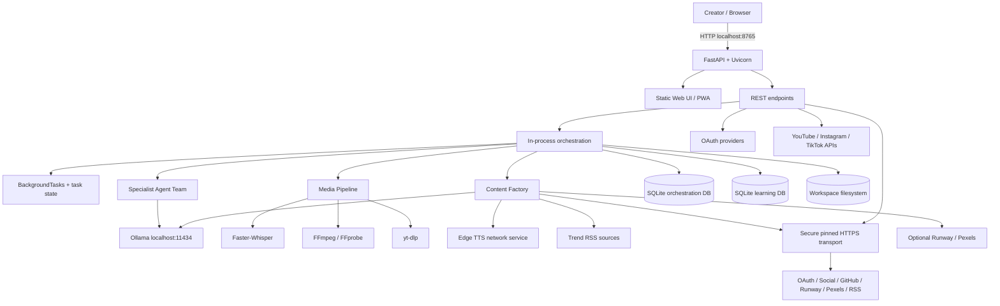
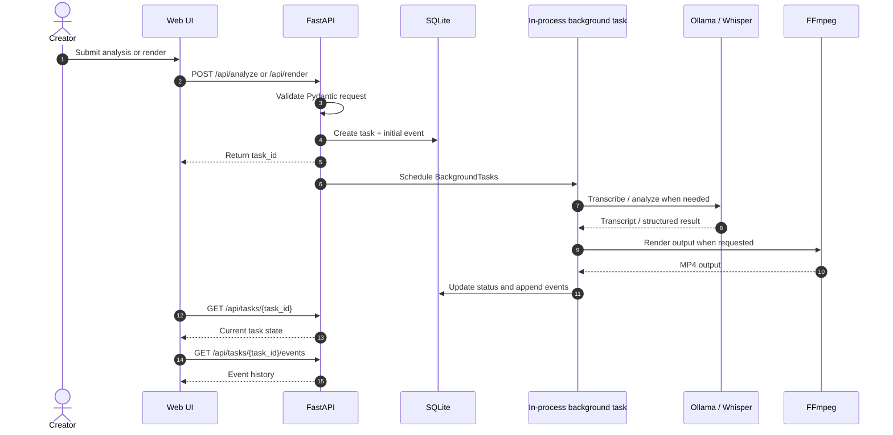
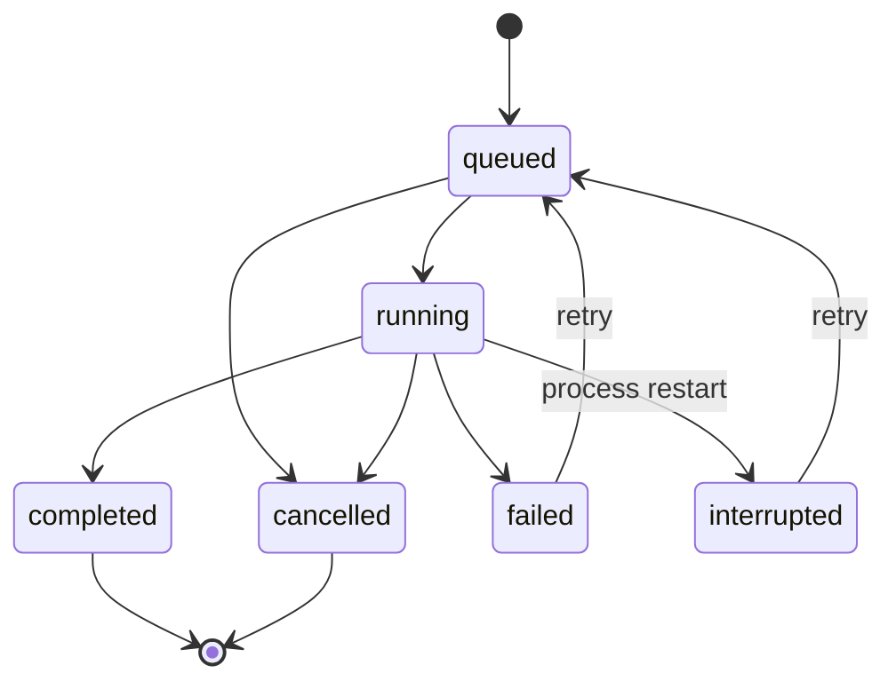
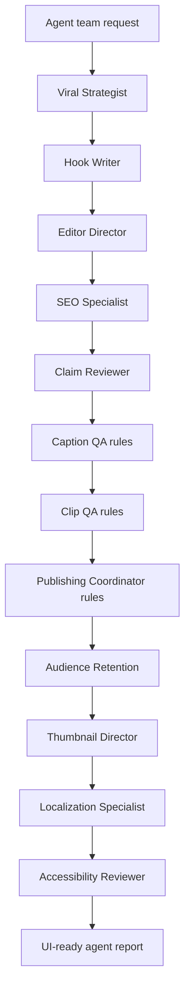

# Engineering Architecture — v1.8.0

> **Scope:** This document describes the inspected v1.8.0 implementation. It is not a claim that every component in the future-state architecture is already shipped.

## 1. Runtime topology

## 2. Component responsibilities

| Component | Current implementation | Responsibility |
|---|---|---|
| Web UI | `web/index.html`, `web/app.js`, `web/style.css` | Creator workspace, job/task status, media and settings UI |
| HTTP API | FastAPI in `app/main.py` | Validation, endpoints, orchestration entry points |
| Task orchestration | FastAPI BackgroundTasks + SQLite task store + worker heartbeat leases | In-process execution; cross-worker task state, event history, cancel/retry and stale-worker recovery |
| Public HTTPS transport | `app/secure_http.py` | DNS/IP validation and pinning, TLS hostname verification, proxy isolation and controlled redirects for requests-based third-party APIs |
| Local LLM | Ollama HTTP API | Script and content analysis, AI agent outputs |
| Speech-to-text | Faster-Whisper | Timestamped transcript segments |
| Media processing | FFmpeg/FFprobe; optional Auto-Editor | Probe, crop, captions, audio/video render |
| Source retrieval | yt-dlp | Retrieves supported source media subject to rights and platform terms |
| Agent team | `app/agents.py` | Task-scoped AI and deterministic QA specialists |
| Content generation | `app/content_factory.py` | RSS trend discovery, Ollama script, Edge TTS narration |
| Visual generation | `app/visual_factory.py` | Optional Runway and Pexels adapters |
| Persistence | SQLite + JSON + local files | Tasks, events, autopilot, learning, jobs, secrets and media |

## 3. Request lifecycle

## 4. Task state model

The task store persists task_id, timestamps, status, percent, stage and payload_json. Event records persist event type, timestamp and payload_json.

Task state reads and writes use SQLite as the cross-worker authority. Each process registers a worker ID and refreshes its heartbeat every 10 seconds. Tasks are marked interrupted only when their owner lease expires (45 seconds) or the owning worker shuts down; another worker starting does not interrupt live tasks. Saved jobs can be rehydrated from validated `job.json` snapshots. Task execution still uses process-local FastAPI BackgroundTasks; a lost task is recovered as interrupted, not automatically replayed. Cancellation is cooperative and depends on checkpoints in the relevant workflow.

## 5. Agent execution topology

The current specialist team is defined in `app/agents.py`. AI specialists call the existing Ollama JSON function; deterministic specialists execute local validators. This is not LangGraph orchestration.

Agent outputs are advisory data. They must never be treated as shell commands, trusted facts or publication authorization. Model failures may return fallback results; callers must inspect each agent's status.

## 6. Storage boundaries

- `workspace/orchestration.sqlite3`: tasks (including worker ownership), task_events, task_workers heartbeat registry, autopilots, autopilot_runs, oauth_states and retry claims.
- SQLite WAL supports multiple Uvicorn workers on one host when the database remains on a local filesystem; it is not a multi-host database/queue.
- `workspace/viral_learning.sqlite3`: performance observations.
- `workspace/<job_id>/job.json`: completed analysis job snapshot.
- `workspace`: media, generated files and encrypted provider/OAuth vault files.
- `settings.local.json`: local model settings.
- `.oauth.key`: default Fernet key file unless an external key is configured.

See [Database ERD](DATABASE-ERD.md).

## 7. External service boundaries

Requests-based third-party HTTPS calls (OAuth, social publishing, GitHub updater, Runway, Pexels and RSS) use the shared pinned transport. Redirects are disabled by default; explicitly enabled GET redirects are revalidated hop by hop and cross-origin authorization/cookie headers are stripped. Local Ollama uses a separate local-service HTTP path. yt-dlp and Edge TTS use their own clients/protocols and are outside the requests-based transport.

| Service | Local or remote | Optional? | Purpose |
|---|---|---:|---|
| Ollama | Local | Yes | Local LLM inference |
| Faster-Whisper | Local after model install | Required for transcription workflows | Speech recognition |
| FFmpeg | Local binary | Required for render workflows | Media processing |
| Edge TTS | Remote service | Yes | Neural voiceover |
| RSS sources | Remote | Yes | Topic discovery |
| Runway | Remote paid/API service | Yes | Generative visuals |
| Pexels | Remote API | Yes | Stock B-roll |
| Social platform APIs | Remote | Yes | OAuth and publishing |

## 8. Current implementation vs. target architecture

The repository's broader `docs/ARCHITECTURE.md` contains a future-state design that mentions LangGraph, PostgreSQL, Redis, tenant isolation and distributed workers. The inspected v1.8.0 runtime and `requirements.txt` do not establish those as active runtime components. Treat them as roadmap/design targets until code, migrations, deployment manifests and tests demonstrate otherwise.

## 9. Security boundaries and release gate

- Current app binds to loopback by default in the Windows launcher; do not expose it to untrusted networks.
- The inspected source does not show a general authentication/authorization layer protecting every API route.
- Workspace files are mounted under `/workspace`; private media access requires additional controls before shared deployment.
- OAuth tokens and provider keys are encrypted locally, but key custody and backup remain operator responsibilities.
- Production readiness requires authentication, per-user authorization, protected media delivery, CSRF/session protections where applicable, rate limits, audit logging, HTTPS, secret management and tested restore procedures.
