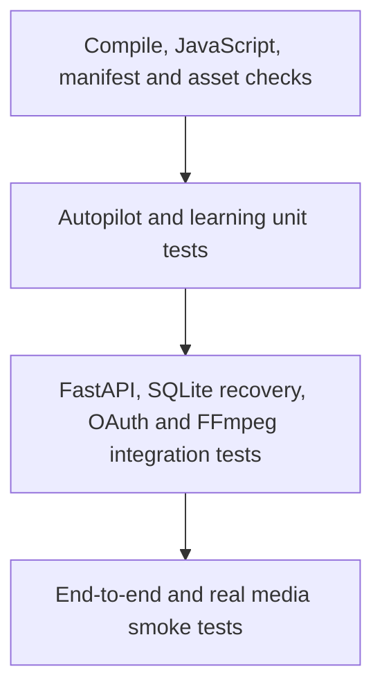

# Quality Engineering & Testing Strategy — v1.8.0

This document distinguishes automated coverage that is implemented and executed from future release-assurance work. Passing tests are evidence for tested paths only, not a security certification.

## 1. QA 3.1 baseline

The test suite now contains **18 automated tests** across deterministic unit and FastAPI integration layers.

| Suite | Coverage | Tests |
|---|---|---:|
| Autopilot | SQLite initialization, create/read, invalid timezone, due/manual claims, run history, processed-file deduplication, deletion | 6 |
| Learning engine | Engagement/retention calculations, minimum sample threshold, platform isolation | 3 |
| FastAPI integration | Health contract, Pydantic validation, unknown task/job, cancellation persistence/idempotency/events, restart recovery, publish confirmation, unsupported provider, invalid and replayed OAuth state | 9 |
| **Total** | | **18** |

API tests use FastAPI TestClient and temporary SQLite databases. Ollama status is stubbed; no real provider or publishing endpoint is called.

## 2. Run locally

Python 3.12 is the supported CI runtime.

```powershell
python -m pip install -r requirements.txt -r requirements-dev.txt
python -m pytest -q
python -m compileall -q app
node --check web/app.js
node --check web/sw.js
```

`requirements-dev.txt` contains test-only dependencies. Application runtime dependencies remain in `requirements.txt`.

## 3. Test pyramid



## 4. QA 3.1 implemented API regression coverage

- `GET /api/health` returns the expected health contract.
- Invalid analysis request values are rejected with HTTP 422.
- Unknown task, job and task-event resources return HTTP 404.
- Task cancellation persists state and is idempotent.
- Task event history records cancellation.
- In-flight tasks are marked interrupted when the task store is reinitialized after a simulated restart.
- Publishing without explicit confirmation is rejected before OAuth token lookup.
- OAuth state is consumed once; a replayed callback is rejected.
- Unsupported publishing providers and invalid OAuth callback state are rejected.

## 5. Defect found and fixed during QA 3.1

The new OAuth callback regression test exposed a first-run failure: the oauth_states table was created only when OAuth authorization was initiated. A callback with an unknown state before any OAuth start therefore raised SQLite OperationalError instead of returning the intended HTTP 400. The table is now initialized with the task store, so invalid callbacks are rejected cleanly. A replay test also verifies that a state is consumed once.

## 5. Remaining coverage priorities

**P0**
- Task retry behavior for agent tasks, including missing project/clip cases.
- OAuth state expiry boundary, one-time state consumption and disconnect vault behavior.
- Secret vault round-trip, wrong-key handling and rotation.
- Workspace path traversal, symlink and URL/SSRF regression cases.
- SQLite multi-connection concurrency and Autopilot double-claim stress tests.
- Synthetic FFmpeg render and ffprobe output validation.

**P1**
- Ollama timeout, connection failure and malformed JSON.
- Agent fallback status and deterministic QA outcomes.
- Mobile browser navigation and PWA flows.
- External provider quota and error handling.

## 6. CI and test design rules

- CI installs application and test dependencies, then runs the same pytest suite.
- No real paid API, live OAuth account or production credential is used in tests.
- Mock external providers and use synthetic or redistributable media.
- Use temporary directories and isolated databases.
- Keep tests deterministic and repeatable.
- Do not silently skip required release checks.

## 7. Release gates

A release candidate requires passing CI and P0 tests, Windows 10/11 + Python 3.12 smoke checks, a rights-cleared media render validated by ffprobe, a verified backup/restore drill, and a clean release archive with no secrets or private media.

## 8. Current limitations

The 18 tests are an expanded QA baseline, not comprehensive coverage. Real FFmpeg output, browser automation, concurrency stress, complete vault lifecycle and security scanning are not yet claimed as passing.

## Related documentation

- [Security & Privacy](wiki/Security.md)
- [Engineering Architecture](ENGINEERING-ARCHITECTURE.md)
- [Operations Runbook](OPERATIONS-RUNBOOK.md)
