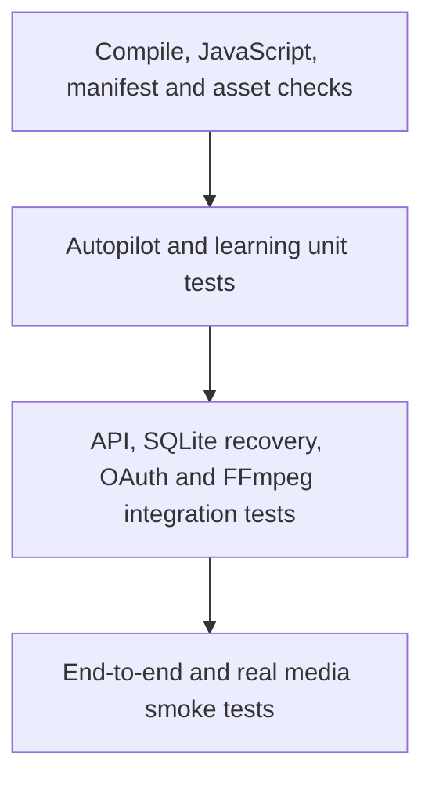

# Quality Engineering & Testing Strategy — v1.8.0

This document distinguishes implemented automated coverage from planned release assurance. A passing test suite is evidence for the tested paths only; it is not a security certification or proof that the entire product is defect-free.

## 1. Quality gates currently implemented

The repository now contains a pytest suite focused on deterministic local logic:

| Suite | Coverage | Current tests |
|---|---|---:|
| Autopilot | SQLite initialization, create/read, invalid timezone, due-run claiming, manual claim states, run history, processed-file deduplication, deletion | 6 |
| Learning engine | Engagement/retention calculations, minimum sample threshold, platform isolation | 3 |
| **Total** | **Unit tests** | **9** |

GitHub Actions continues to validate Python compilation, required assets, selected UI/source invariants, PWA manifest JSON and JavaScript syntax. It additionally installs pytest and runs the unit suite.

## 2. Run locally

Python 3.12 is the supported CI runtime.

```powershell
python -m pip install pytest
python -m pytest -q
python -m compileall -q app
node --check web/app.js
node --check web/sw.js
```

Tests use temporary SQLite databases and must not write to the operator's real workspace or production database.

## 3. Test pyramid



## 4. Coverage status and next priorities

| Area | Status | Priority / next action |
|---|---|---|
| Autopilot scheduling and persistence | Unit tests added | Expand weekly/DST and concurrent process cases |
| Learning calculations | Unit tests added | Add zero-view, boundary and malformed-data cases |
| FastAPI API contracts | Not yet covered by TestClient | P0: health, request validation, unknown task/job |
| Task store recovery/cancellation/retry | Not yet covered | P0: restart interruption, event history, retry semantics |
| OAuth lifecycle | Not yet covered | P0: invalid/expired state, disconnect, token redaction |
| Publishing safety | Not yet covered | P0: reject without explicit confirmation |
| Secret vault | Not yet covered | P0: round-trip, wrong key, key rotation |
| Path and URL safety | Partial source controls exist; regression tests pending | P0: traversal, redirect/SSRF and symlink cases |
| FFmpeg output | Not yet automated | P0: synthetic clip, ffprobe validation, missing binary |
| AI provider failures | Not yet covered | P1: timeout, connection failure, malformed JSON |
| Agent QA and fallback | Not yet covered | P1: deterministic rule outcomes and fallback status |
| Browser/mobile flows | Static checks only | P1: responsive navigation and key workflows |

## 5. Test design rules

- Never call paid or production provider APIs from CI.
- Mock Ollama, OAuth providers, publishing endpoints and external HTTP.
- Use generated or redistributable synthetic media; never commit private or copyrighted user media.
- Use `tmp_path` for SQLite and filesystem tests.
- Assert observable outcomes and error contracts, not private implementation details.
- Test timezone-aware values explicitly; include Europe/Istanbul and daylight-saving zones where applicable.
- Keep tests deterministic, isolated and safe to run repeatedly.
- Do not silently skip a required release test because a binary or provider is unavailable; mark optional integration tests explicitly.

## 6. Release gates

A release candidate must satisfy all of the following before being described as production-ready:

1. All static checks and unit tests pass in CI.
2. P0 API, task recovery, OAuth, publishing-confirmation, vault and path-safety tests pass.
3. Windows 10/11 and Python 3.12 smoke checks pass.
4. A synthetic or rights-cleared sample completes transcription, render and ffprobe playback validation.
5. Backup and restore are exercised on a copy of the workspace.
6. Release diff and archive contain no credentials, private media or local configuration.
7. Security limitations and external provider permissions are disclosed.

## 7. Current limitations

The current nine unit tests are the first automated quality baseline, not comprehensive coverage. FastAPI integration tests, real FFmpeg output tests, browser automation, concurrency stress tests and security scanning remain future work. Do not claim those checks have passed until they are implemented and executed.

## Related documentation

- [Security & Privacy](wiki/Security.md)
- [Engineering Architecture](ENGINEERING-ARCHITECTURE.md)
- [Operations Runbook](OPERATIONS-RUNBOOK.md)
