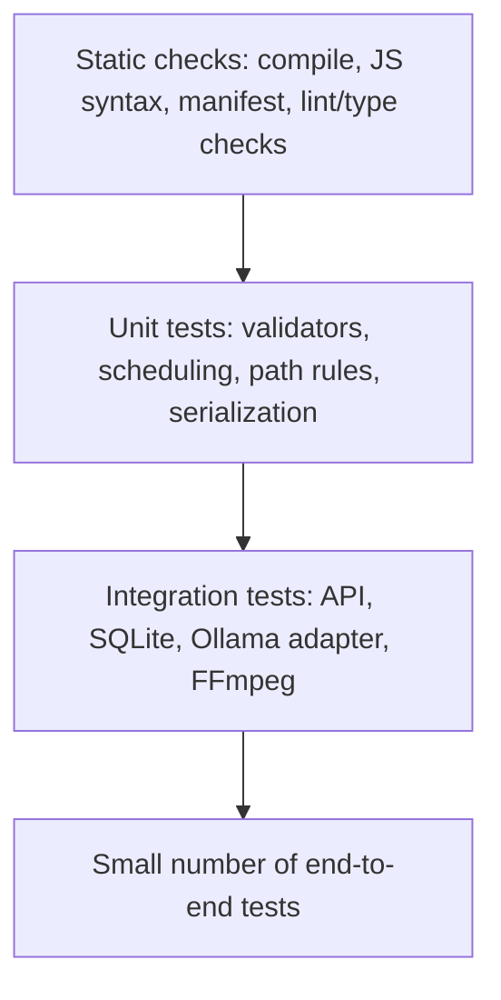

# Testing Strategy — v1.8.0

## 1. Current automated checks

The existing GitHub Actions workflow `.github/workflows/ci.yml` runs on push, pull request and manual dispatch. It currently performs:
- Python module compilation with Python 3.12.
- Required frontend and static asset existence checks.
- Selected source/UI feature-presence checks.
- JSON parsing for the PWA manifest.
- JavaScript syntax checks with Node.

These are useful smoke/structure checks. They are not a replacement for unit, integration, end-to-end, security or media-output tests.

## 2. Test pyramid

## 3. Priority test matrix

| Area | Test | Expected result | Priority |
|---|---|---|---|
| API | Invalid clip count / duration | HTTP 422 | P0 |
| API | Unknown task/job ID | HTTP 404 | P0 |
| Task store | Queued/running task on restart | Marked interrupted with event | P0 |
| Task store | Cancel running task | Cooperative cancellation state | P0 |
| Task store | Retry failed/interrupted task | New execution or explicit rejection | P0 |
| Media | Missing FFmpeg | Actionable error; no corrupt output | P0 |
| Media | Invalid source path | Rejected before file access | P0 |
| Media | Render valid sample | MP4 exists, non-zero, ffprobe-readable | P0 |
| Transcription | Ollama unavailable | Transcription can proceed if LLM not needed; clear fallback/error | P1 |
| AI agents | Invalid JSON / timeout | Fallback status, no crash | P1 |
| AI agents | Rule checks | Deterministic pass/fail with evidence | P1 |
| Autopilot | Daily/weekly schedule | Correct timezone and next_run | P0 |
| Autopilot | Concurrent due-run claim | Plan is not claimed twice | P0 |
| Learning | Fewer than 3 samples | Adjustment remains zero | P1 |
| OAuth | Invalid state / expired state | Callback rejected | P0 |
| OAuth | Disconnect | Local credentials removed | P0 |
| Publishing | confirm_publish false | Publication rejected | P0 |
| Secrets | Vault encryption/decryption | Round-trip works; wrong key fails safely | P0 |
| Frontend | Narrow mobile viewport | No overflow; navigation usable | P1 |
| PWA | Manifest/service worker | Valid JSON and root scope behavior | P1 |

## 4. Test fixtures

Maintain small, redistributable fixtures:
- 15–30 second MP4 with speech, silence and music.
- Transcript fixture with timestamps and Turkish diacritics.
- Invalid/truncated media file.
- Local mock Ollama responses: valid JSON, malformed JSON, timeout and connection error.
- OAuth callback fixtures with valid, expired and mismatched state.
- SQLite database fixtures for task recovery and Autopilot claims.

Do not commit copyrighted user media or production secrets as fixtures.

## 5. Recommended implementation sequence

1. Add pytest and temporary-directory SQLite fixtures.
2. Unit-test `app/autopilot.py` scheduling, claiming and finish-run behavior.
3. Unit-test `app/learning.py` aggregation and sample thresholds.
4. Add FastAPI TestClient tests for health, request validation and task lookup.
5. Mock Ollama, OAuth and external HTTP providers; do not call real APIs in CI.
6. Add FFmpeg integration tests using a generated synthetic sample video.
7. Add security regression tests for path containment, URL validation and publication confirmation.
8. Add mobile browser smoke tests for key navigation and forms.

## 6. Release gates

A release candidate should not be promoted until:
- All CI checks pass.
- P0 tests pass on Windows 10/11 and Python 3.12.
- One real sample video completes transcription, clip render and playback validation.
- OAuth callback and publication confirmation tests pass with mocked providers.
- Backup/restore has been exercised on a copy of the workspace.
- Secrets and private media are absent from the Git diff and release archive.
- Known limitations and provider review requirements are disclosed.
