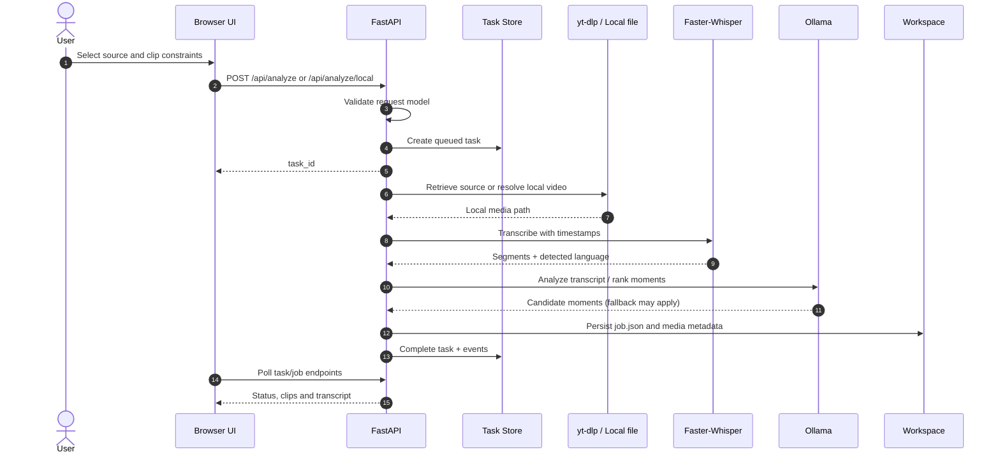
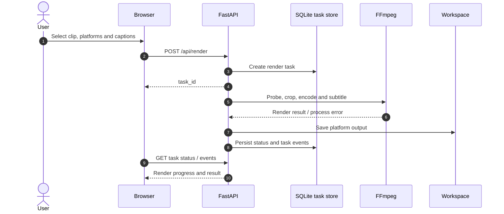
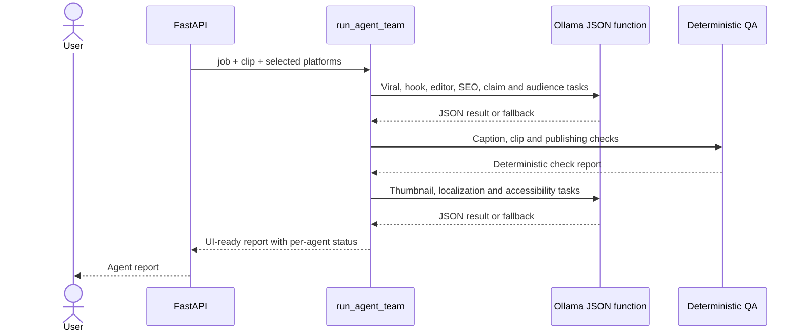
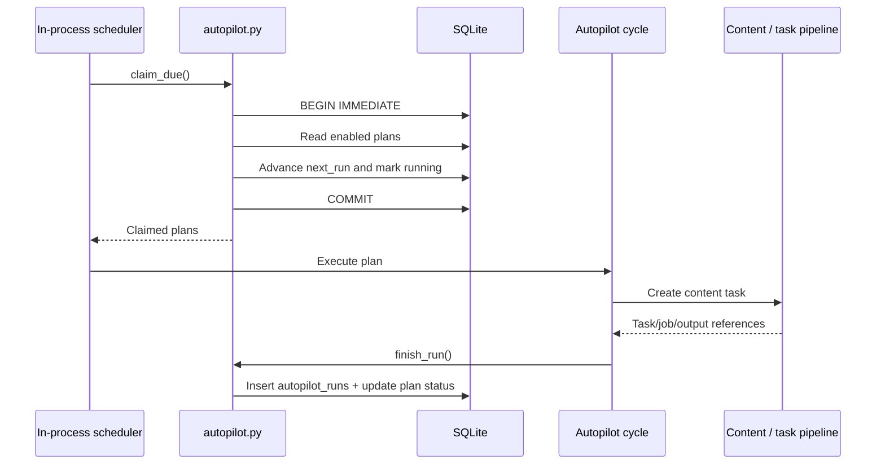
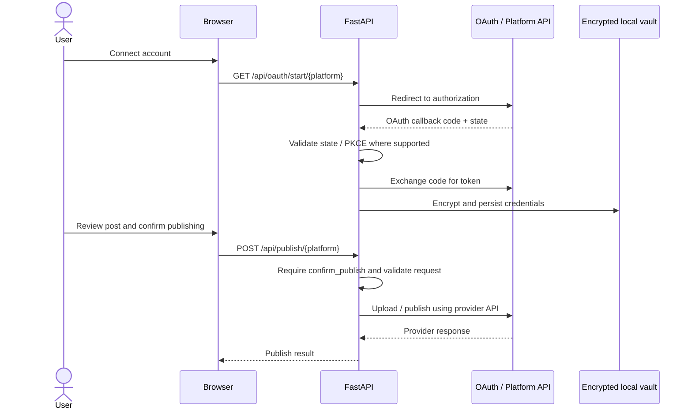

# Workflow Sequences — v1.8.0

## 1. Source video analysis

## 2. Clip render

## 3. AI agent report

The agent sequence is a logical overview. Individual agent calls are sequential in the current implementation, not a parallel graph. Model failures may produce fallback status.

## 4. Autopilot scheduling

Autopilot schedules content production. It does not grant unattended social publishing permission. Publishing is a separate operation.

## 5. OAuth and publication approval boundary

OAuth app approval, scopes, account eligibility, quota and platform policy can limit publication. No diagram implies that provider app review has already been granted.
