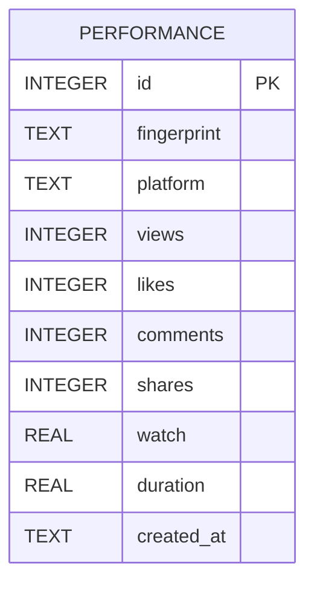

# Database ERD

The current v1.8.0 runtime uses local SQLite and filesystem-backed job snapshots. Relationships shown below are logical; the inspected tables do not declare SQL foreign-key constraints.

```mermaid
erDiagram
  TASKS {
    TEXT task_id PK
    TEXT created_at
    TEXT updated_at
    TEXT status
    INTEGER percent
    TEXT stage
    TEXT payload_json
  }
  TASK_EVENTS {
    INTEGER id PK
    TEXT task_id FK_LOGICAL
    TEXT event_type
    TEXT created_at
    TEXT payload_json
  }
  AUTOPILOTS {
    TEXT id PK
    TEXT name
    TEXT niche
    TEXT language
    INTEGER clips
    INTEGER min_seconds
    INTEGER max_seconds
    TEXT platforms_json
    TEXT frequency
    TEXT publish_time
    TEXT timezone
    INTEGER enabled
    TEXT next_run
    TEXT last_status
    TEXT processed_json
  }
  AUTOPILOT_RUNS {
    TEXT id PK
    TEXT autopilot_id FK_LOGICAL
    TEXT started_at
    TEXT finished_at
    TEXT status
    TEXT message
    TEXT task_id
    TEXT job_id
    TEXT output_json
  }
  OAUTH_STATES {
    TEXT state PK
    TEXT platform
    TEXT verifier
    TEXT redirect_uri
    REAL created_at
  }
  TASKS ||--o{ TASK_EVENTS : task_id
  AUTOPILOTS ||--o{ AUTOPILOT_RUNS : autopilot_id
```

## Separate learning database



- `orchestration.sqlite3`: tasks, task_events, autopilots, autopilot_runs and oauth_states.
- `viral_learning.sqlite3`: performance observations.
- `workspace/{job_id}/job.json`: transcript, clip candidates and job metadata.
- Encrypted vault files store OAuth and optional provider credentials.

The learning engine's adjustment helper returns zero until at least three samples exist for a platform. It is a lightweight heuristic, not a trained model.

Full schema, storage lifecycle and backup notes: [Database ERD source](https://github.com/Myozan/YAMAN-VIRAL-STUDIO-PRO/blob/import/v1.8.0-premium-ai-creator-studio/docs/DATABASE-ERD.md).
