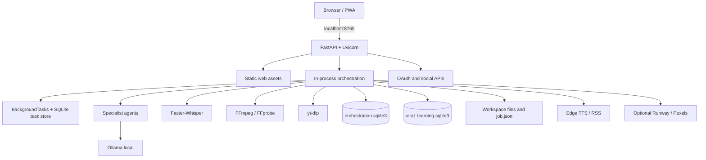
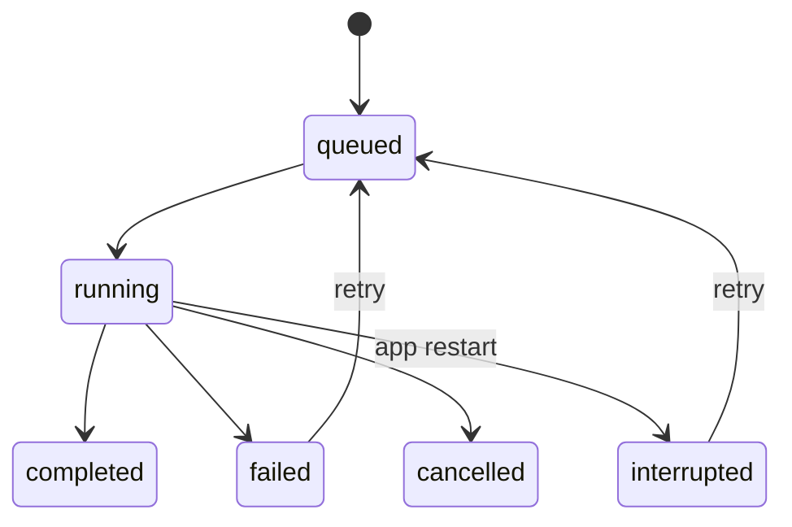

# Engineering Architecture

This page documents the **verified v1.8.0 runtime**. The broader [Architecture](https://github.com/Myozan/YAMAN-VIRAL-STUDIO-PRO/blob/import/v1.8.0-premium-ai-creator-studio/docs/ARCHITECTURE.md) file describes a future-state design.

## Runtime diagram

## Current technology

| Layer | Implementation |
|---|---|
| API | Python 3.12, FastAPI, Uvicorn |
| UI | HTML, CSS, JavaScript, PWA |
| Local LLM | Ollama |
| Speech-to-text | Faster-Whisper |
| Media | FFmpeg / FFprobe, optional Auto-Editor |
| Source retrieval | yt-dlp |
| Persistence | SQLite, JSON, filesystem |
| Agent team | Task-scoped Ollama calls + deterministic validators |

## Task lifecycle

The task system is in-process. It is not a distributed worker queue. Existing queued/running tasks are marked interrupted on startup.

## Important security note

The inspected v1.8.0 source does not show a general authentication and authorization layer protecting every API route. The app is intended for local use. Do not expose it to a LAN or public internet without authentication, per-user access control, private media protection, HTTPS, rate limiting and audit logging.

## Full diagrams

See [Engineering Architecture](https://github.com/Myozan/YAMAN-VIRAL-STUDIO-PRO/blob/import/v1.8.0-premium-ai-creator-studio/docs/ENGINEERING-ARCHITECTURE.md) and [Workflow Sequences](https://github.com/Myozan/YAMAN-VIRAL-STUDIO-PRO/blob/import/v1.8.0-premium-ai-creator-studio/docs/WORKFLOW-SEQUENCES.md).
