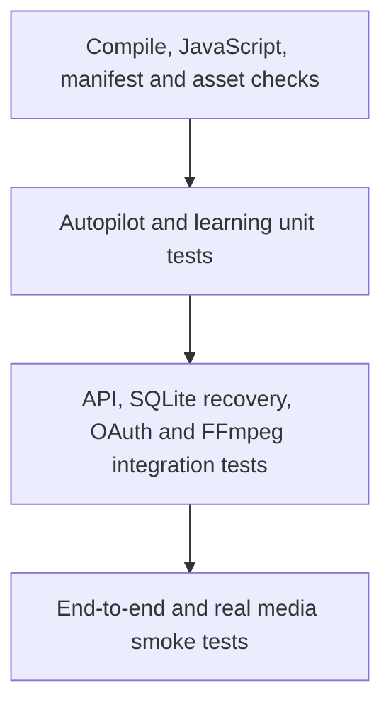

# Quality Engineering & Testing Strategy

The repository now has a first deterministic pytest baseline: **9 unit tests** covering Autopilot persistence/claiming and Learning Engine calculations. GitHub Actions runs these tests alongside compilation, asset, manifest and JavaScript checks.

## Run locally

```powershell
python -m pip install pytest
python -m pytest -q
python -m compileall -q app
node --check web/app.js
node --check web/sw.js
```

## Implemented unit coverage

| Area | Coverage | Tests |
|---|---|---:|
| Autopilot | Initialization, create/read, invalid timezone, due and manual claims, run history, processed-file deduplication, deletion | 6 |
| Learning | Engagement/retention, three-sample threshold, platform isolation | 3 |
| **Total** | | **9** |

Tests use temporary SQLite databases. They do not touch the user's production workspace or call external providers.

## Test pyramid



## Next coverage priorities

**P0**
- FastAPI health, request validation and unknown task/job responses.
- Task restart recovery, cancellation, retry and event history.
- OAuth invalid/expired state and disconnect behavior.
- Reject publishing unless explicit confirmation is supplied.
- Secret vault round-trip, wrong-key handling and rotation.
- Workspace path traversal, symlink and URL/SSRF regression cases.
- Synthetic FFmpeg render and ffprobe output validation.

**P1**
- Ollama timeout, connection failure and malformed JSON.
- Agent fallback status and deterministic QA outcomes.
- Mobile browser navigation and PWA flows.
- External provider quota and error handling.

## CI and test design rules

- No real paid API, live OAuth account or production credential in CI.
- Mock external providers and use synthetic or redistributable media.
- Use temporary directories and isolated databases.
- Keep tests deterministic and repeatable.
- Do not silently skip required release checks.

## Release gates

A release candidate requires passing CI and P0 tests, Windows 10/11 + Python 3.12 smoke checks, a rights-cleared media render validated by ffprobe, a verified backup/restore drill, and a clean release archive with no secrets or private media.

**Scope note:** the nine tests are an initial baseline, not comprehensive coverage. FastAPI integration, FFmpeg output, browser automation, concurrency stress and security scanning are not yet claimed as passing.

Full detail: [Quality Engineering & Testing Strategy](https://github.com/Myozan/YAMAN-VIRAL-STUDIO-PRO/blob/import/v1.8.0-premium-ai-creator-studio/docs/TESTING-STRATEGY.md).
