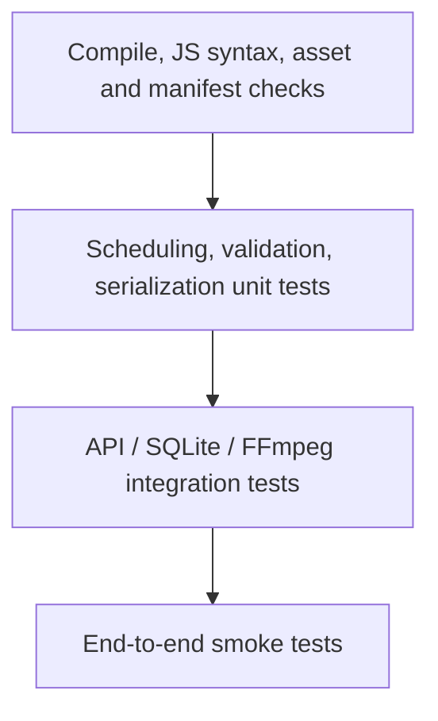

# Testing Strategy

The current GitHub Actions workflow performs Python compilation, frontend asset existence checks, selected feature-presence checks, PWA manifest JSON parsing and JavaScript syntax validation. It does not yet constitute a complete automated test suite.

## Test pyramid

## P0 test priorities

- API request validation and unknown task/job handling.
- Task interruption and retry after application restart.
- Autopilot timezone scheduling and concurrent due-run claiming.
- OAuth state validation and expiry.
- Publishing rejection without `confirm_publish`.
- Secret vault encryption/decryption and wrong-key behavior.
- FFmpeg valid sample render and missing-binary error.
- Workspace path containment and URL restrictions.

## P1 test priorities

- Ollama malformed JSON, timeout and connection failure.
- Agent fallback status and deterministic QA rules.
- Learning metrics and minimum sample threshold.
- Mobile viewport and PWA navigation.
- Optional provider errors and quota handling.

## CI gap

Before a release is treated as production-grade, add pytest unit tests, FastAPI TestClient integration tests, mocked provider tests and FFmpeg fixture tests. CI should not call real paid APIs or require live OAuth accounts.

Full matrix and release gates: [Testing Strategy](https://github.com/Myozan/YAMAN-VIRAL-STUDIO-PRO/blob/import/v1.8.0-premium-ai-creator-studio/docs/TESTING-STRATEGY.md).
