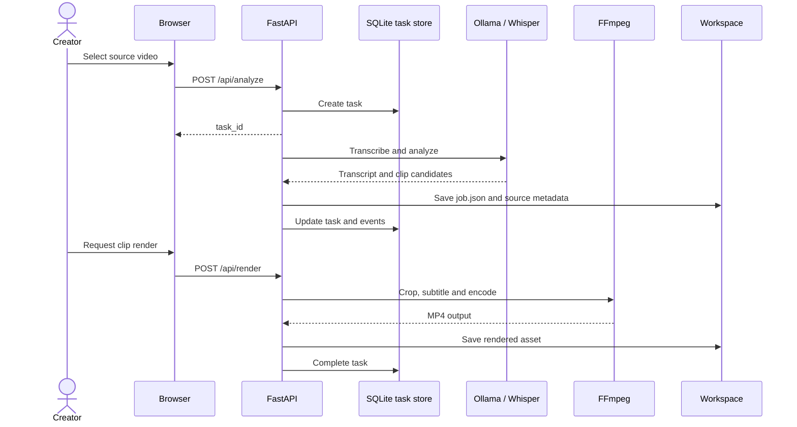
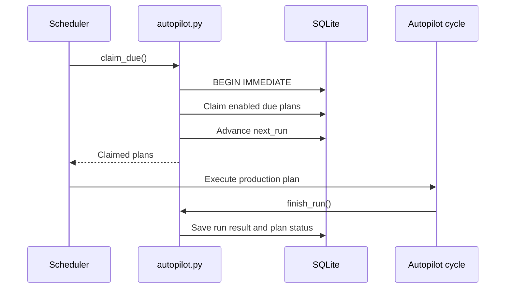

# Workflow Sequence Diagrams

## Video analysis and rendering

## Agent team

The specialist agents are currently executed sequentially. AI agents call Ollama; rule-based agents perform deterministic checks. A model error may yield a fallback result. Agent output is advisory, not publication approval.

## Autopilot

Autopilot schedules production, not unconditional social publishing.

## OAuth publishing boundary

Account connection, token exchange and upload require provider API permissions and account eligibility. Publishing requires an explicit confirmation flag. Provider app review and quotas remain external dependencies.

Full sequence documentation: [Workflow Sequences](https://github.com/Myozan/YAMAN-VIRAL-STUDIO-PRO/blob/import/v1.8.0-premium-ai-creator-studio/docs/WORKFLOW-SEQUENCES.md).
